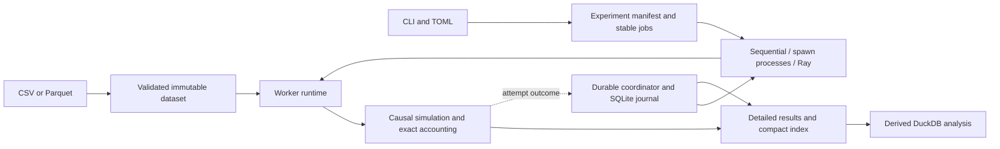

# Distributed Backtesting Engine

A Python platform for running independent daily strategy simulations through
sequential, multiprocessing and Ray execution, with deterministic accounting,
durable retries and reproducible engineering measurements.

Built as a quantitative software engineering portfolio. **Version `0.8.0`.**
The SMA strategy is a small, inspectable workload for studying correctness,
execution overhead, scheduling and failure recovery. The project uses synthetic
reference data and does not establish investment performance or production readiness.

## Run the included example

Use Python 3.12+ in Terminal or the VS Code terminal, from a checkout:

```bash
python3 -m venv .venv-core
.venv-core/bin/python -m pip install --editable .
.venv-core/bin/distributed-backtester backtest \
  --config examples/backtest.toml --fee-bps 10
```

The core has **no runtime dependencies**. The bundled
[CSV](examples/sma.csv) and [TOML settings](examples/backtest.toml) need no account
or market-data download. Expected reference:

| Result | Value |
| --- | ---: |
| Fills | 2 |
| Final equity, USD | 749.257000 |
| Fees, USD | 1.743000 |
| Total return | -25.0743% |
| Maximum drawdown | 25.0743% |

Output is JSON with settings, input fingerprint, trades, order outcomes, equity
and metrics. Use `--output PATH` to save it. The
[beginner guide](docs/clear%20explanation.md) walks through the arithmetic and
explains the terms; [reproduction instructions](docs/reproducibility.md) cover
fresh environments and installed wheels.

Run four independent configurations on two local workers:

```bash
mkdir -p artifacts
.venv-core/bin/distributed-backtester sweep --config examples/sweep.toml \
  --fee-bps 10 --backend process --workers 2 --output-dir artifacts/process
.venv-core/bin/distributed-backtester status --output-dir artifacts/process
```

The output directory must be new. Expect four successes and no failures.
`manifest.json` describes the jobs, `index.json` summarizes them,
`results/JOB_ID.json` retains complete simulations, and `execution.json` records
operational observations. See [CLI reference](docs/cli-reference.md) for flags,
Ray, durable mode, storage, logging and benchmark commands.

## Correctness contract

1. The strategy observes closes through session T and emits a target after close.
2. The engine fills it at the next supplied session's open, using available cash
   and configured fees.
3. It marks portfolio equity at that session's close.

Validated bars are immutable and strictly ordered. Whole-share, long-only USD
accounting uses integer micro-dollars and half-even fee rounding. Strategy
history exposes only available closes; execution mechanics own sizing/fills.
Independent hand-calculated cases, lookahead tests and complete result comparisons
check these boundaries. Final pending intents are canceled; holdings are marked
without forced liquidation. See [technical contracts](docs/technical-explanation.md).

## Architecture



These are modules and calls, not separate services. Each simulation owns one
portfolio; workers do not share mutable strategy state. Durable Ray adds one
coordinator, a local POSIX journal, deadlines, bounded retries, generation fencing
and idempotent result commits. A calculation may run again after a lost reply;
its committed result stays unique. DuckDB and JSON exports are derived outputs.

Explore the [architecture and contracts](docs/architecture.md),
[engineering deep dive](docs/engineering-deep-dive.md) and
[architecture decisions](docs/decisions/README.md). The
[failure demonstration](docs/fault-tolerance-demo.md) reproduces real injected
worker/coordinator failures and explains the actual execution guarantees.

## Measured engineering results

Historical measurements on Apple M3 Pro, 11 cores, 18 GiB, macOS ARM64,
CPython 3.14.6. Timers include fresh-process startup, data load, full detail export
and shutdown. These are recorded workloads/releases, not new `0.8.0` benchmarks.

| Experiment | Workload | Observed result |
| --- | --- | --- |
| Phase 2, `0.3.0`, local scaling | 64 jobs x 4,096 bars | Two processes: 2.069 s sequential to 1.321 s median, 1.566x; four/eight workers were slower than two |
| Phase 6, archived `0.7.0` revisions, optimization | 32 jobs x 16,384 bars | Sequential median: 3.821517 s to 2.667269 s, 30.20% lower runtime, 1.433x |
| Same Phase 6 comparison, process/Ray | Same substantial workload | Process changes under 1%; cold Ray samples 1.30-7.05% slower after optimization |

Small workloads favored sequential execution. Cold Ray startup outweighed its
parallel compute benefit in these comparisons. Phase 2 memory used sampled
process-tree RSS, which can count shared pages more than once; private USS peaks
were unavailable in Ray/Phase 6 measurements. Few samples and uncontrolled host
conditions limit statistical and causal conclusions.

[Benchmark/scaling analysis](docs/benchmark-results.md) links raw observations,
revision identities, ranges, memory limits and reproduction procedures. The
[profiling guide](docs/performance.md) documents effective and unsuccessful
optimization experiments.

## Verify and operate

```bash
python3 -m venv .venv
.venv/bin/python -m pip install --editable '.[dev,benchmark,distributed,storage]'
PHASE5_STORAGE_CHILD_TESTS=1 .venv/bin/python -m pytest -q
.venv/bin/python -m ruff check .
.venv/bin/python -m ruff format --check .
.venv/bin/python -m mypy
.venv/bin/python -m pip check
.venv/bin/python -m build
```

[Fresh installed-wheel checks](docs/reproducibility.md) run outside the checkout
and verify actual package imports, causal reference output, backend equality,
logs/status, signals, journal recovery, Parquet and DuckDB. Freeze package source
while workers run. Optional native checks require local process/socket access;
missing extras cause skips and must be reported.

[Development](docs/development.md) documents installed nonroot Docker runtime/dev
images, an immutable Python base and Linux hash locks.
[Operations](docs/operations.md) covers resource quotas, persistent named outputs,
stop/kill/resume and SQLite bookkeeping permissions. The configured GitHub Actions
workflow runs tests, Ruff, mypy and installed checks. Remote CI and Linux AMD64
execution remain unobserved; the [Phase 7 report](docs/phase-7-report.md) records
actual Linux ARM64 image and recovery checks. Current documentation/release checks
are recorded in the [Phase 8 report](docs/phase-8-report.md).

## Limits and tradeoffs

- Daily single-asset simulation; no intraday order book, market impact, liquidity
  limits, dividends/splits, leverage, shorting or exchange calendar.
- Raw-price data needs a caller-established corporate-action policy. An incomplete
  historical universe cannot establish freedom from survivorship bias.
- Durable execution uses one local POSIX journal and one coordinator. It has no
  replicated state, disk-loss failover, network-partition or power-loss guarantee.
- Physical multi-machine throughput and steady-state cluster scaling were not
  measured. Worker reservations are not measured CPU utilization.
- Native shutdown has no fixed bound. SIGKILL relies on journal recovery;
  application JSON logs may accompany native diagnostic text on stderr.

See [complete limitations](docs/limitations.md) and the
[deep dive](docs/engineering-deep-dive.md) for decisions and larger-scale proposals.

## Reading paths

| Goal | Start here |
| --- | --- |
| Understand or run your first backtest | [Beginner explanation](docs/clear%20explanation.md), [reproduction](docs/reproducibility.md) |
| Review implementation and invariants | [Technical explanation](docs/technical-explanation.md), [architecture](docs/architecture.md), [deep dive](docs/engineering-deep-dive.md) |
| Evaluate measurements | [Benchmark synthesis](docs/benchmark-results.md), [methodology](docs/benchmarking.md), [profiles](docs/performance.md) |
| Inspect failure recovery | [Demonstration](docs/fault-tolerance-demo.md), [reliability](docs/reliability.md), [operations](docs/operations.md) |
| Prepare for an interview | [Project summary and three resume candidates](docs/portfolio-summary.md) |
| Review project history | [Roadmap](docs/roadmap.md), [decisions](docs/decisions/README.md), [phase reports](docs/phase-8-report.md) |

Phase 8 portfolio work follows the approved roadmap. Git changes stay reviewable
on feature branches; remote push/publication requires explicit authorization.
Licensed under [MIT](LICENSE).
