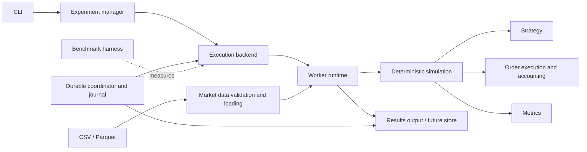
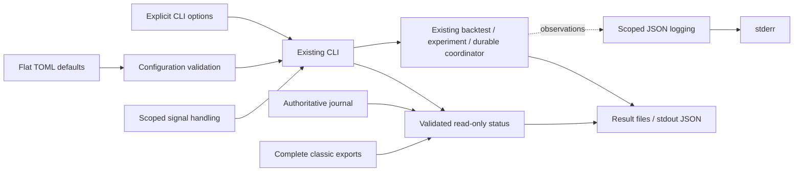

# Architecture

## Status and scope

This document describes the implemented system through Phase 7.
**Phase 7 is complete, version `0.8.0`.** Native, installed-wheel and Linux ARM64
runtime/dev release checks passed; see the [Phase 7 report](phase-7-report.md)
and [verification record](phase-7-verification.json).
Phase 8 is unapproved and requires explicit approval. Phase 0 established the
foundation; the approved Phase 1 implements strict CSV loading, SMA signals,
exact execution/accounting, a deterministic simulation, metrics, JSON export,
and a CLI. Phase 2 adds stable jobs, parameter sweeps, sequential and process
backends, initialized workers, incremental export, and a benchmark harness.
Phase 3 adds the optional Ray actor pool and an existing-cluster connection.
Phase 4 adds a local SQLite scheduler, retry policy, and Ray recovery. Phase 5
adds exact versioned Parquet inputs, explicit verified caching, and DuckDB
analytical snapshots. Phase 6 adds scoped profiling, full-result comparison,
bounded native history slicing, and exact integer drawdown comparison. See the
[Phase 2 report](phase-2-report.md) and [Ray instructions](ray-clusters.md).
Phase 7 adds configuration, logging, status, signal handling, and installed
Docker packaging around the existing CLI. Remote CI and Linux AMD64 execution
remain unobserved. Historical Phase 6 measurements refer to the archived
`0.7.0` implementations; they establish no new Phase 7 performance result.

The engineering goal is reproducible independent simulations, reliable execution,
and honest measurements. Strategy profitability is outside the acceptance criteria.

## Chosen approach

Use one Python package with focused modules and explicit data contracts. A
simulation operates on validated, immutable market data and configuration. It
returns a structured result without reading files, contacting a scheduler, or
writing to a database. Adapters perform those operations around the simulation.

| Approach | Benefits | Costs | Decision |
| --- | --- | --- | --- |
| Modular package | Easy to inspect and test; same simulation runs on every backend | Requires discipline about module boundaries | Use initially |
| Separate services immediately | Independent deployment and resource ownership | Network and recovery protocols precede a correct simulation | Reconsider when a measured operational need appears |
| Array-first research framework | Convenient bulk analytics | Can obscure order timing and accounting state; requires numerical dependencies immediately | Add arrays where measurements and semantics justify them |

## Logical components



Arrows show data flow or calls, not independent services. In Phase 1, the CLI
loads the data and calls the simulation directly. In Phase 2, sweeps use the
experiment manager, backend, and worker runtime. Phase 4 durable sweeps add a
coordinator journal around the Ray attempt runtime.

| Component | Responsibility | Inputs and outputs | First needed |
| --- | --- | --- | --- |
| Market data | Parse and validate data; describe provenance and price basis | Data source and metadata -> immutable dataset | Phase 1 |
| Strategy | Decide desired exposure using only available history | Past/current closes and portfolio view -> optional target intent | Phase 1 |
| Simulation | Advance sessions and order the events | Dataset and configuration -> semantic result | Phase 1 |
| Order execution/accounting | Size and fill intents; apply fees; enforce cash/position invariants | Pending intent, next open, portfolio -> fill or rejection and updated portfolio | Phase 1 |
| Metrics | Derive return and drawdown from recorded equity | Equity path including initial capital -> metrics | Phase 1 |
| Experiment manager | Expand a parameter grid and create a manifest | Dataset reference and configurations -> ordered jobs | Phase 2 |
| Execution backend | Run jobs with interchangeable execution mechanisms | Jobs -> one structured outcome per job | Phase 2 |
| Worker runtime | Resolve data and invoke a fresh simulation | Job and accessible dataset -> result or structured failure | Phase 2 |
| Job scheduler | Own durable lifecycle, attempts, leases, and retry decisions | Manifest and worker observations -> assignments and terminal outcomes | Phase 4 |
| Results store | Persist and query outcomes and provenance | Results/metadata -> committed records and queries | JSON in Phase 1; durable commits in Phase 4; analytics in Phase 5 |
| Benchmark harness | Measure execution under declared workloads | Manifest, backend, environment -> raw samples and summaries | Phase 2 |

The scheduler owns lifecycle state. The simulation owns one portfolio. Workers
never mutate the same portfolio and do not directly own durable commit decisions.

## Minimal directory structure

Current structure (phase reports/plans and additional unit tests abbreviated):

```text
.github/workflows/ci.yml
.gitignore
.dockerignore
Dockerfile
LICENSE
MANIFEST.in
README.md
pyproject.toml
src/distributed_backtester/
    __init__.py
    __main__.py
    money.py
    models.py
    data.py
    market_data.py
    dataset_identity.py
    parquet_data.py
    strategy.py
    execution.py
    simulation.py
    metrics.py
    results.py
    cli.py
    cli_options.py
    cli_lifecycle.py
    configuration.py
    operational_logging.py
    operational_status.py
    jobs.py
    provenance.py
    worker.py
    experiments.py
    experiment_artifacts.py
    experiment_snapshot.py
    analytics.py
    scheduler/
        models.py
        journal.py
        coordinator.py
        ray_runtime.py
        experiments.py
    workloads.py
    benchmark.py
    measurement.py
    ray_benchmark.py
    ray_measurement.py
    storage_benchmark.py
    storage_measurement.py
    profiling.py
    performance.py
    backends/
        base.py
        sequential.py
        process.py
        ray.py
    py.typed
tests/
    test_packaging.py
    test_data.py
    test_strategy.py
    test_simulation.py
    test_cli.py
examples/
    sma.csv
    backtest.toml
    sweep.toml
requirements/
    container-build.lock
    container-runtime.lock
    container-dev.lock
scripts/
    smoke.py
docs/
    architecture.md
    roadmap.md
    dependencies.md
    testing.md
    benchmarking.md
    clear explanation.md
    technical-explanation.md
    development.md
    operations.md
    phase-0-plan.md
    phase-0-report.md
    phase-1-plan.md
    phase-1-report.md
    phase-2-plan.md
    phase-2-report.md
    phase-3-plan.md
    phase-4-report.md
    phase-5-plan.md
    phase-5-report.md
    phase-6-plan.md
    phase-6-report.md
    phase-7-design.md
    phase-7-plan.md
    phase-7-report.md
    phase-7-verification.json
    storage.md
    ray-clusters.md
    benchmarks/phase-2/
        results.md
        small.json
        substantial.json
    decisions/
        README.md
        0001-modular-package.md
        0002-simulation-semantics.md
        0003-reproducibility-and-results.md
        0004-bounded-local-execution.md
        0005-ray-actor-execution.md
        0006-durable-scheduling.md
        0007-versioned-storage-and-analytics.md
        0008-measured-performance.md
        0009-operational-interface.md
```

Execution has its own small module because fee rounding, affordability, timing,
and order rejection have independent reference tests. `simulation.py` owns event
ordering; `results.py` owns serialization and complete-file publication.
Phase 2 adds focused experiment, job, worker, provenance, backend, and benchmark
modules. Phase 4 adds scheduler
and persistence modules. No empty subsystem packages are created in advance.

## Implemented and future contracts

Phase 1 through Phase 7 contracts match their implemented modules. The verified
Phase 7 operational interfaces are described below. Future contracts require
documented decisions and approval at phase gates.

| Contract | Fields and rules |
| --- | --- |
| `Bar` | ISO session date; integer micro-dollar open/high/low/close; integer nonnegative volume |
| `DatasetMetadata` | Symbol, currency (`USD` initially), `raw` price basis, CSV byte SHA-256, validation schema version |
| `MarketDataset` | Metadata plus an immutable ordered tuple of bars; at least one bar |
| `StrategyConfig` | Moving-average windows with `1 <= fast < slow`; sizing is fixed by the engine semantics |
| `BacktestConfig` | Strategy config, positive initial cash in micro-dollars, nonnegative integer proportional fee in basis points |
| `TargetIntent` | Target exposure `flat` or `invested`; decision session; order sequence number |
| `Portfolio` | Immutable cash and whole-share holdings visible after the current close mark |
| `CloseHistory` | Read-only prefix of frozen session/close observations; captured bounds cannot extend as later closes arrive |
| `Fill` | Decision and execution sessions; side; whole-share quantity; open price; rounded fee; cash after fill |
| `OrderOutcome` | Filled, no change needed, rejected, or canceled; reason such as no affordable share or end of dataset |
| `EquityPoint` | Session, cash, holdings, close price, equity in micro-dollars |
| `BacktestResult` | Schema version, engine/strategy identity, data/config provenance, fills, order outcomes, equity path, final holdings/cash, metrics |
| `JobSpec` (Phase 2) | Stable ID, dataset reference/digest, full config, engine identity; JSON-serializable and immutable |
| `JobOutcome` (Phase 2) | Job ID and either result or structured failure; execution metadata kept outside the semantic result |
| Compact outcome JSON (Phase 2) | Compact job ID/status, relative result artifact reference, content digest, and summary metrics |
| `ExperimentSummary` (Phase 2) | Counts and paths; on disk, manifest and job-ID-sorted compact index; full equity paths remain in per-job artifacts |

Implemented signatures:

```text
load_csv(path: Path, *, symbol: str, price_basis: Literal["raw"]) -> MarketDataset
run_backtest(config: BacktestConfig, dataset: MarketDataset, *, strategy: Strategy | None = None) -> BacktestResult
strategy.on_close(history: CloseHistory, portfolio: Portfolio) -> TargetIntent | None
execute_intent(intent: TargetIntent, execution_session: date, open_price: int, portfolio: Portfolio, fee_bps: int) -> tuple[Portfolio, OrderOutcome]
calculate_metrics(initial_cash: int, equity: Sequence[EquityPoint], fills: Sequence[Fill] = ()) -> Metrics
serialize_result(result: BacktestResult) -> str
write_result(result: BacktestResult, path: Path, *, overwrite: bool = False) -> None
```

`CloseHistory` exposes only the prefix through the current session. Passing the
full dataset plus an index to arbitrary strategy code would expose future values.
The default strategy instance and portfolio are fresh for each simulation; loaded
market data can be reused because it is immutable. Caller-supplied strategies must
own/reset their state. An explicitly supplied built-in SMA must match the reported
configuration. Arbitrary custom hooks support causal/reference tests; their results
cannot be exported as semantic JSON until their parameters and versioned identity
have a supported provenance contract. Phase 1 export supports the built-in SMA.

Implemented Phase 2 backend contract:
`ExecutionBackend.iter_outcomes(jobs: Sequence[JobSpec], dataset: MarketDataset, implementation: ImplementationIdentity) -> Iterator[JobOutcome]`.
The dataset and installed identity initialize the backend once per run. Workers
receive only small job specs after initialization.

## Daily execution and strategy semantics

For every supplied session:

1. Execute the previous session's pending intent at this session's open.
2. Record cash, holdings, and equity marked at this session's close.
3. Give the strategy history through this close and the current portfolio view.
4. Store the resulting intent for the next supplied session's open.

The first session has no pending order. The last session's intent is recorded as
canceled because no next open exists. Open holdings stay open and are marked to
the final close; there is no implicit sale or final liquidation fee.

An SMA strategy compares the latest `fast` and `slow` windows of closes. Before
`slow` observations it emits no intent. Once ready, `fast > slow` requests
invested exposure and `fast < slow` requests flat exposure. Equality preserves
the prior target; initial target is flat. Emit an intent only when the target
changes, including an initial ready positive comparison. This is a target regime
convention; it does not require a previous fully warmed comparison on entry.
The convention has dedicated warm-up, regime, equality, and repeat-run tests.

An invested intent buys the greatest affordable whole-share quantity using the
next open and fees. A flat intent sells all current shares. Already-invested
portfolios are not rebalanced daily. A rejected intent is not automatically
reissued without a new target change. Explicit quantity orders, when introduced,
must reject nonpositive quantities or quantities exceeding cash/holdings.

At an overnight price gap, sizing after the open becomes available avoids using
a quantity affordable only at yesterday's close. The strategy chooses exposure
after T's close; the execution model performs declared cash-constrained sizing
at T+1's open. This is an idealized model, not a claim that a real broker can
always fill a cash-target order at the exact opening price.

## Accounting and fees

- Use whole shares and Python integer micro-dollars: one dollar is 1,000,000 units.
- Parse decimal price text exactly at the input boundary. Reject values that are
  not exactly representable at six fractional decimal places; do not truncate.
- Cash, trade notional, and marked equity use integer arithmetic.
- Fees are proportional basis points of trade notional, rounded once to the
  nearest micro-dollar using round-half-even; record each charged fee. This is an
  ideal proportional-fee model, without a broker's cent rounding or minimum fee.
- Buy cash change is `-(quantity * open_price + fee)`; sell cash change is
  `quantity * open_price - fee`.
- Fee configuration is limited to integer values from 0 through 10,000 bps in
  this initial model. No fixed fee or minimum fee is implied.
- Compute affordable quantity against the final rounded fee, with a boundary
  check. Do not subtract fees after choosing an unaffordable quantity.
- After every fill, `cash >= 0` and `holdings >= 0`. Equity is exactly
  `cash + holdings * close_price`.
- Ratios use exact `Fraction` values internally; cash/fills/equity remain exact, and
  JSON money values use fixed six-place decimal strings rather than JSON floats.
  Canonical export sorts keys and expresses return/drawdown ratios as twelve-place
  decimal strings rounded half-even from the integer numerator/denominator.

This deliberately limits the input precision and currency scope. Decimal would
also be valid with an explicit context and rounding policy; fixed units make
accounting invariants direct and avoid ambient decimal-context dependencies.
No performance benefit is asserted for either representation.

Total return is `final_equity / initial_cash - 1`. Maximum drawdown is the
largest nonnegative `(running_peak - equity) / running_peak` over the sequence
`[initial_cash, close_equity_1, ...]`. The initial anchor captures losses on the
first invested mark. Always report final equity, number of fills, and total fees.
Annualized returns and Sharpe ratios require frequency/risk-free-rate conventions
and are deferred until those conventions have an explicit use and tests.

## Market data policy

The Phase 1 schema is `date,open,high,low,close,volume`, one symbol and USD currency
per dataset. Dates are exchange session labels in `YYYY-MM-DD` format, not UTC
instants. They must be unique and strictly increasing. "Next day" means the next
supplied session, including weekend and holiday gaps.

Reject empty input, missing/unknown/duplicate columns, missing fields, nonfinite
or nonpositive prices, negative/nonintegral volume, duplicate or decreasing dates,
and inconsistent OHLC ranges (`low <= open,close <= high`). Error messages identify
the source row/field. A file with a header and no bars is empty input.

Missing session rows cannot be reliably inferred from dates alone. Phase 1 has
no exchange calendar and does not promise detection of missing trading sessions.
The caller is responsible for supplying the intended complete session sequence.
It performs no sorting, imputation, deduplication, or forward filling. Explicit
offline repair can be added separately with recorded provenance.

Use consistently raw, unadjusted OHLC prices. The declaration comes from dataset
metadata or CLI input; numeric values alone cannot establish adjustment history.
Synthetic data has no corporate actions. The caller must establish that a supplied
real-data interval has no corporate actions; OHLC alone cannot prove that condition.
Real datasets spanning splits/dividends
are outside Phase 1's validated economic model. A column of adjusted closes mixed
with raw opens is invalid for this model. Adjusted OHLC and corporate-action
accounting need a separate design before real-data performance claims.

## Determinism, identity, and errors

Identical validated data, configuration, and engine identity must yield identical
semantic output. No wall clock, process ID, worker count, file path, or completion
order belongs in that output. Execution observations have a separate envelope.
Market-data hashes are computed from the same immutable byte snapshot that is
parsed; hashing a file again after loading could identify different content.

Phase 1 records installed package release plus daily engine semantics in
`engine_id`, and an SMA semantics identifier. A release label is not a cryptographic
source identity: editable changes can retain the version. Record the exact Git
revision and environment for reproduction. Phase 2 adds an installed-source
fingerprint to job and manifest identity. Sorted package-relative Python filenames
and source bytes are length-framed and hashed, independently of installation path.
Git revision/status and installed dependency versions are operational context in
`execution.json` and benchmark reports. A wheel can be hashed without a Git checkout.
Changing an auxiliary Python module conservatively changes every job ID; source
must stay fixed during a run. This hash is provenance, not a hostile-code sandbox.

JSON publication writes and flushes/fsyncs a temporary sibling before publishing.
Without overwrite, a hard link fails if the destination already exists; explicit
overwrite uses `os.replace`. The CLI rejects resolved paths and existing hard links
aliasing the input. This protects normal local use, not hostile concurrent filesystem
changes or crash recovery. No directory fsync or durable scheduling guarantee is
claimed. Filesystems must support these local publication operations. Publication
is the commit point; a subsequent cleanup failure logs a warning and does not
turn the completed export into an error. Rejected fields with malformed types
use null in JSON diagnostics, retaining the rejection reason.

Phase 2 hashes canonical serialized configuration, dataset byte digest and policy,
strategy/engine identity, installed-source fingerprint, and schema version to form job IDs. Paths and attempt
IDs are not job identity. Different byte encodings of otherwise equal CSVs may
receive different IDs; conservative identity is acceptable initially. Duplicate
grid configurations collapse to one job with the manifest recording the mapping.
Process backend delivery follows completion order. The experiment manager exports each
outcome to a per-job artifact and releases its full result before collecting more.
It returns a compact job-ID-sorted index, so final output is deterministic without
retaining every equity path or waiting for an early slow job to finish first.
Job metadata and the compact index still grow with the number of jobs.

Backend equivalence uses identical source artifacts and checks full canonical
semantic results, including provenance. In Phase 5, CSV-to-Parquet conversion
changes the source-byte digest and therefore job identity. Cross-format equivalence
first verifies identical validated bars/configuration/policy, then compares fills,
order outcomes, equity, final cash/holdings, and metrics. Check each artifact's
provenance separately and record conversion lineage; do not remove provenance from
same-source backend tests or silently reuse a different artifact's byte digest.

Malformed data and invalid configurations fail before simulation. An invalid
execution intent has an explicit recorded rejection. Unexpected invariant
violations raise an error and fail the job. Do not convert a crashed simulation
into a successful empty result. CLI failure exits nonzero and must not publish
a success artifact. Phase 2 isolates ordinary job exceptions; classic process-pool failures still abort. Phase 4 durable recovery initially
supports the Ray attempt runtime.

## Concurrency and distributed evolution

Phase 2 implements a sequential reference backend and `ProcessPoolExecutor`
using explicit spawn semantics. Each process initializes a dataset once for a
common-data sweep; jobs carry references/configuration instead of whole datasets.
Use bounded submissions and incremental result export to control outstanding
futures and detailed result copies. The results sink belongs to the experiment
manager; backends yield outcomes without owning persistence. Export completion
defines successful collection for the experiment, and export errors must fail it.
A fresh output directory contains `manifest.json`, `results/<job_id>.json`,
`execution.json`, and `index.json`. The index is published last, after complete
collection and backend shutdown. Ordinary job failures get artifacts; unknown,
duplicate, missing, or mismatched outcomes, broken pools, and export errors abort
without a finalized index. Partial files may remain. No automatic cleanup,
retry, or resume is implemented on this classic path. Phase 4 durable Ray mode
adds a separate journal and recovery coordinator.
There is still one in-memory dataset copy per process; measure it before
adding shared memory or memory-mapped storage.

Phase 3 implements Ray as an optional actor backend without importing it on
sequential paths. A fixed worker pool checks installed source identity once per
actor and uses the existing `execute_job` function with fresh strategy state.
The coordinator puts common data once into Ray's object store. That store is not
one shared-memory region across machines: serialization, inter-node movement,
eviction, spill, and remote dataset availability must be measured. Local multi-node
testing exercises protocol behavior but cannot establish cross-machine scaling.
Per-actor CPU/custom resources, bounded submissions, explicit zero restarts/retries,
and owned actor/connection cleanup are documented in
[ADR 0005](decisions/0005-ray-actor-execution.md). Local clusters are stopped at
iterator completion; externally started clusters remain running. Operational
worker/node/timing diagnostics do not enter semantic identity.

Phase 4 defines scheduler states `pending`, `running`, `succeeded`, and `failed`,
with retryable attempts returning to `pending`. A scheduler is the single durable
writer; workers submit outcomes with job and attempt identifiers. A persistent
SQLite journal implements atomic result/lifecycle transactions using the
standard library. DuckDB imports verified terminal snapshots for analytics;
workers never write either database.

The intended guarantee is at-least-once execution with at most one durable
successful result per stable job ID, within one authoritative coordinator/store.
Use transactions, uniqueness, attempt fencing, bounded retries, and content-hash
checks. Identical duplicate outcomes are safe; divergent duplicates surface a
correctness error. Timeouts must address work still running after expiration,
rather than merely abandoning a future. Single-coordinator high availability,
network filesystems, and durable recovery after disk loss are outside that initial
guarantee. Phase 4 failure-injection evidence must precede reliability claims.

## Principal risks

| Risk | Mitigation and evidence |
| --- | --- |
| Lookahead or unavailable execution price | Prefix-only strategy input; next-open event order; future-suffix mutation tests |
| Cash errors after gaps/fees | Execution-time sizing; exact units; hand-calculated cases and invariants |
| Adjustments or silent data repair | Declared raw price basis; strict validation; separate preprocessing provenance |
| Shared strategy state or completion-order dependence | Fresh state per job; canonical IDs; sorted result index; backend equivalence tests |
| Full-result accumulation exhausts coordinator memory | Bounded in-flight outcomes; incremental artifacts; compact index; sweep-size memory measurements |
| Parallel overhead exceeds useful work | Small and substantial workloads; include startup/loading; measure total process memory |
| Duplicate commits or stale worker results | Durable uniqueness, transactions, fencing, and failure injection in Phase 4 |
| Overstated reproducibility or performance | Engine/data/environment manifests; raw benchmark samples; no simulated speedups |
| Premature infrastructure obscures correctness | Phase gates; dependency additions tied to observed needs |

## Validation and supporting decisions

See [testing](testing.md), [benchmarking](benchmarking.md),
[dependencies](dependencies.md), and the [phase roadmap](roadmap.md).

- [ADR 0001: Modular package](decisions/0001-modular-package.md)
- [ADR 0002: Simulation semantics](decisions/0002-simulation-semantics.md)
- [ADR 0003: Reproducibility and results](decisions/0003-reproducibility-and-results.md)

Implementation phases require their own reviewed plans. These future contracts
can change with documented reasoning and approval at the corresponding checkpoint.


## Phase 4 implementation: durable coordinator

Durable sweeps are an additional execution path; classic streaming backend APIs
remain available. `scheduler/models.py` defines immutable policy, lease, and reply
contracts. `journal.py` owns the local SQLite state, advisory writer lock, unique
commits, and restart reconciliation. `coordinator.py` owns deadlines and retry
scheduling. `ray_runtime.py` uses the shared Ray pool lifecycle and retires failed
actors. `scheduler/experiments.py` validates inputs for start and resume.

The journal stores complete canonical terminal artifacts alongside job state in
one transaction. Successful exports use the same shared serializer as classic
collection. JSON files are derived, repairable copies. Job attempt IDs and session
generations fence expired or interrupted replies. Only one coordinator writes;
workers never access the journal. Read-only status remains available during work.

This phase supports local POSIX journals and Ray workers. It does not implement a
new durable process backend, journal replication, or multiple-coordinator failover.
The retry budget includes the first attempt and remains fixed on resume. Source
and dataset identity must match before journal state is changed. Resource settings
may change. See [ADR 0006](decisions/0006-durable-scheduling.md),
[reliability](reliability.md), and [Phase 4 report](phase-4-report.md).

## Phase 5 implementation: data and analytical projections

`market_data.py` selects CSV or Parquet and optionally reuses immutable data
through `DatasetCache`. `dataset_identity.py` defines canonical normalized bar
hashes and the logical version descriptor. `parquet_data.py` performs strict
Arrow schema/metadata validation and bounded row-group writes. The engine,
strategies, and worker contract continue to consume `MarketDataset`.

`experiment_snapshot.py` verifies complete experiment outcomes from classic
exports or a consistent read-only journal transaction. It streams detailed
artifacts rather than accumulating every equity curve. `analytics.py` imports
that snapshot atomically into DuckDB. Experiments, job definitions, outcome
content, snapshot membership, and source observations have distinct identities.
The same experiment can have several terminal snapshots after operational
failures; identical imports deduplicate. The journal retains authority.

`storage_measurement.py` and `storage_benchmark.py` record format loading,
verified cache reuse, repeated sequential experiments, payload size, serialization,
same-host process transfer, and process high-water memory. Fresh processes do not
evict the filesystem cache. See [storage](storage.md) and
[ADR 0007](decisions/0007-versioned-storage-and-analytics.md).


## Phase 6 implementation: measurement and exact optimization

`profiling.py` separates instrumented CPU/allocation observations from repeated
uninstrumented simulation/complete-sequential-experiment timings. It verifies
complete result hashes and frozen source/data; failures preserve their primary
exception even when observation or publication also fails.

`performance.py` consumes retained outputs from the existing local Ray harness.
It verifies each producer's manifest, input bytes, full successful snapshots,
commands, child/parent environment and resource policy before comparing all
result fields in canonical configuration order. Source-dependent job IDs remain
independent. Only a validated engine release label may be normalized.

`CloseHistory` uses native slicing only for exact built-in backing and its base
class, normalized to the captured prefix. Empty/reverse slices and custom
integer access retain their contracts. Metrics compare drawdown ratios using
unbounded integer cross products, constructing final exact fractions once.
The public strategy, worker, scheduler, storage and accounting contracts remain
compatible. Read [performance](performance.md) and
[ADR 0008](decisions/0008-measured-performance.md) for measured choices and limits.

## Phase 7 implementation: operational boundaries

**Phase 7 complete, version `0.8.0`.** This phase wraps existing
execution with configuration, observation, read-only status, shutdown handling
and installed packaging. It adds focused modules inside the same Python CLI
package. The simulation still consumes validated immutable inputs and returns
semantic results. No new runtime dependency, frontend or service is introduced.
Phase 8 is unapproved and needs explicit approval.



These arrows are calls or data flow within existing processes. Status is a
separate CLI invocation, and operational events describe execution without
becoming semantic output or authoritative scheduler state.

| Boundary | Owner and contract |
| --- | --- |
| Configuration | `configuration.load_configuration(path, command)` validates flat schema version 1 and command-specific TOML fields, resolving file paths against the config directory |
| CLI defaults | `cli_options.configuration_defaults(argv)` prepares the existing parser; explicit values and negative boolean switches override defaults; the first explicit worker-resource flag replaces the configured array and subsequent flags append to the new CLI list |
| Observations | `operational_logging` scopes its own logger/handler/context, defaults OFF, writes JSON to stderr and restores caller state |
| Worker propagation | Process initializers and Ray actor construction receive serializable `LogState`, reconstructing local logging without inheriting handler/stream objects |
| Saved status | `operational_status.read_status(output, job_id=...)` reuses validated read-only journal state or fully consumes a classic snapshot before publication/filtering |
| CLI interruption | `cli_lifecycle.cli_signals()` translates the first SIGINT/SIGTERM into existing cleanup paths and restores caller signal handlers; a Ray-version-bound private adapter preserves startup ownership |
| Installed environment | Docker builder/runtime/dev targets install the wheel, existing optional extras and pinned Linux dependency closures |

TOML is flat and only `backtest`, `sweep`, and `resume` accept `--config`.
`schema_version` and matching `command` are required; cash stays decimal text,
sweep windows are integer arrays, and malformed/unknown/nonfinite values are
rejected before application output creation. File defaults use file-relative
paths; CLI paths use the current working directory. `--no-overwrite` and
`--no-durable` can explicitly reverse configured true values. These are IO and
validation boundaries around existing domain constructors.
Resource parsing leaves configuration/parser defaults unchanged, including
when a parser is reused; omitting resource flags retains the configured array.

Logging defaults to OFF and carries schema/version, UTC timestamp, level, event,
PID and applicable experiment/job/attempt/generation correlation. Ray retains
actor-local session logs with `log_to_driver=False`; driver events describe
collection and durable outcomes. Commit observations follow returned journal
commit calls. Delivery is best effort, and logging failures must not replace
the workload's result or primary exception. Logs confer no commit, liveness,
timing or durability guarantee.
Native Ray/Abseil failure traces can also appear on stderr. Only application
records follow the JSON observation schema.

Status validates the whole experiment before selecting a job. A present journal
is authoritative, and invalid journal state never falls back to derived files.
Classic reads validate every artifact and require complete publication; partial
classic exports are explicit errors. Job selection narrows jobs/attempts and
retains experiment events while counts stay aggregate. Retained classic worker
metadata means last observed, not currently alive; durable status omits worker
identities. Status takes no coordinator lock and starts no workers or recovery.
Validated journal reads can maintain SQLite SHM or an empty WAL; authoritative
database, lock, export and nonempty-WAL bytes remain covered by smoke checks.

The interruption contract includes startup, with controlled
SIGTERM/SIGINT exits 143/130 after normal unwind. The
bridge preserves a `KeyboardInterrupt` subclass, signal-specific mapping after
native translation to plain `KeyboardInterrupt`, and driver handler restoration
around Ray initialization. Ray 2.59.0 has no public startup-registration opt-out;
the version-bound adapter in `backends/ray.py` preserves the active main-thread
CLI bridge through its private registration helper, delegates platform
registration and restores the helper on exit. Library callers and other threads
retain Ray's registration behavior. Review the adapter together with the Ray pin
when upgrading.

Actual native registration and post-CoreWorker-construction probes returned 143,
restored caller handlers and left Ray disconnected. These are concrete startup
checks, without exhaustive timing-interleaving or external-cluster coverage.
The first signal during owned cleanup is deferred until cleanup finishes, and
secondary failures are retained on the primary interruption. Cleanup closes
owned resources and releases the journal writer lock, but has no guaranteed
short bound; process pools may wait for running work. Docker can force SIGKILL
after its stop timeout. Classic exports have no resume contract. Durable resume
keeps single-coordinator exclusion, attempt fencing and saved retry budgets,
requiring the same dataset/source/engine identity. Keep the entire output tree
and use the same built image for restart. A version tag alone is insufficient.

The Dockerfile uses matching stages from official
`python:3.12.15-slim-bookworm` pinned to index digest
`sha256:34386ef0cb081344d7ec1c103ba398e6e9f64e9ab3a1509accc92a4e24a07258`.
Both runtime and default dev targets use the installed wheel in `/opt/venv`,
UID/GID `10001:10001`, working directory `/outputs`, an exec entrypoint and
SIGTERM stop signal. Dev additionally holds source/fixtures in `/workspace`
for checks. The binary hash locks cover Linux amd64/arm64 on Python 3.12.15
bookworm; macOS observed dependency snapshots are not universal locks. Published
AMD64 base support and resolved wheel hashes do not establish AMD64 execution.

Final native verification passed 1,928 tests in 231.48 seconds, including five
operational native cases; Ruff passed with 147 files formatted, mypy checked 102
source files and pip reported no broken requirements. The installed core helper
passed. Actual Linux ARM64 runtime/dev builds used Python 3.12.15, glibc 2.36 and
UID 10001. The final runtime helper passed Ray/storage/signals; the dev installed
core helper and static/dependency checks passed. The
[report](phase-7-report.md) and [verification record](phase-7-verification.json)
retain the source/image identities and exact commands.

Actual Docker stop/INT/KILL drills returned 143/130/137 with OOM false. All
same-image resumes advanced generation 1 to 2 with unique committed results and
validated exports. These observations retain the existing local journal and
single-coordinator contract; they add no service or scheduling guarantee.
Remote CI, Linux AMD64, the complete Linux dev-image test suite, Docker Desktop
bind-filesystem durability, power-loss recovery and external-cluster behavior
remain unobserved. This phase supplies no new performance or memory result, and
the archived Phase 6 evidence remains unchanged. See the
[operations design](phase-7-design.md), [implementation plan](phase-7-plan.md),
[development](development.md), [operations](operations.md), and
[technical contracts](technical-explanation.md#phase-7-operational-interfaces).
