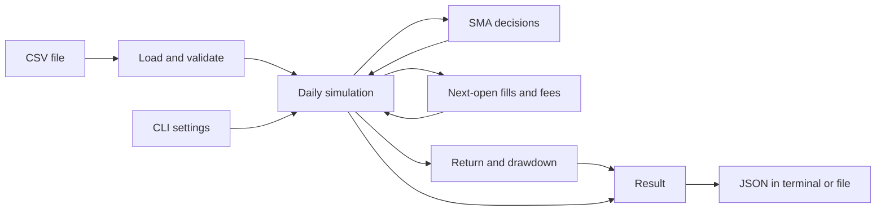

# Clear explanation

## What the program does today

A **backtest** replays historical prices and follows a trading rule. It records
hypothetical purchases, sales, fees, cash, and the value of shares still held.
Phase 1 implements that replay for one asset, one daily price table, and one set
of settings at a time. The current package release is `0.2.0`.

You can run the command below and get a JSON result containing the settings,
data fingerprint, trades, order outcomes, daily portfolio values, and summary
metrics. It uses whole shares and USD, and can hold shares or cash. This is
**long-only** trading: it cannot sell borrowed shares or borrow money to buy more.

The project name describes its eventual direction. Parameter sweeps, multiple
workers, multiple machines, automatic recovery, databases, and performance
benchmarks are planned for later phases. Phase 1 runs in a single process and has
no runtime dependencies beyond Python's standard library.

## Python and the tools in simple terms

Python 3.12 or newer runs the program. A **package** is the collection of Python
modules that make up this project. A **virtual environment**, named `.venv` here,
is a project folder containing the Python environment and installed tools.
Activating it makes terminal commands use that environment.

From the repository directory, the setup commands are:

```bash
python3 --version
python3 -m venv .venv
source .venv/bin/activate
python -m pip install --editable ".[dev]"
```

`pip` installs the package. `--editable` lets the installation use the source
under `src/`, so edits there are available without reinstalling each edit.
`[dev]` also installs the development tools. Those tools help check and package
the code; they are not required libraries for the simulation itself.
`python -m ...` asks the selected Python interpreter to run an installed module.

| Tool | Job |
| --- | --- |
| pytest | Runs automated examples and checks against expected behavior |
| Ruff | Finds code issues and checks consistent formatting |
| mypy | Checks whether the declared types fit together |
| build and setuptools | Create installable wheel and source-distribution files |
| `pip check` | Checks whether installed package requirements conflict |
| GitHub Actions / CI | Runs configured checks when changes are submitted to GitHub |

These checks address different problems. A successful build establishes that
packaging worked; simulation checks establish the trading rules. Configured CI
also needs an observed run before claiming it passed. See the
[README](../README.md) for the development commands and the
[Phase 1 verification report](phase-1-report.md) for actual verification evidence.

## Run the included example

After setup, run this from the repository directory:

```bash
python -m distributed_backtester backtest \
  --data examples/sma.csv \
  --symbol SYNTH \
  --price-basis raw \
  --fast 2 --slow 3 \
  --initial-cash 1000 --fee-bps 10 \
  --output artifacts/example.json
```

The installed command `distributed-backtester backtest` accepts the same options.
The module name uses an underscore; the installed command uses a hyphen. You can
also use `.venv/bin/python` in place of `python` to select the project environment
directly without activating it.

| Command or option | Meaning |
| --- | --- |
| `backtest` | Runs one daily SMA simulation |
| `--data examples/sma.csv` | Required path to the input CSV price table |
| `--symbol SYNTH` | Required asset label saved in the result; it does not download or filter prices |
| `--price-basis raw` | Required declaration that prices are unadjusted; `raw` is the only supported choice |
| `--fast 2` | Short moving average uses the latest 2 closes; default is 2 |
| `--slow 3` | Long moving average uses the latest 3 closes; default is 3; both windows must be positive integers and fast must be smaller |
| `--initial-cash 1000` | Starts with $1,000 and no shares; default is 1000; must be positive and exactly representable in millionths of a dollar |
| `--fee-bps 10` | Charges 10 basis points, or 0.1%, of each trade's value; default is 0; accepts integers from 0 through 10000 |
| `--output artifacts/example.json` | Saves JSON to this file, creating parent folders if needed; omit it to print JSON in the terminal |
| `--overwrite` | With `--output`, permits replacing an existing result file; otherwise an existing destination is refused |
| `-h` / `--help` | Shows help; use `python -m distributed_backtester backtest --help` for the options |
| `--version` | Use `python -m distributed_backtester --version` to show the installed package version |

Running the example again with the same output path requires `--overwrite` or a
new destination. The output cannot refer to the input CSV. Invalid settings,
bad data, or file errors produce a nonzero exit and a readable error message.
Invalid data is rejected before a new result is saved.

Once a complete output file has been published, saving has succeeded. If removing
its temporary helper file then fails, the program logs a cleanup warning and
keeps the successful exit status. That warning does not invalidate the result.

## What the trading rule means

A **simple moving average**, or **SMA**, is the average of the most recent chosen
number of closing prices. Every price in that window has equal weight. The rule
compares a short average with a longer one.

The strategy starts with a target of cash, called `flat`. With fast 2 and slow 3,
the first two closes are **warm-up**: there are too few prices for the longer
average, so no order is requested. At the third close, a higher fast average
requests shares, called `invested`. It can enter on that first ready positive
comparison; it does not need an earlier comparison that was negative.

A lower fast average requests cash. Equal averages preserve the previous target.
An order is requested only when the target changes. Staying invested does not
buy more or rebalance every day. If cash cannot afford even one share including
the fee, the entry is recorded as rejected. The built-in strategy does not retry
it merely because the price later becomes cheaper; it needs a new target change.

## When information becomes available

A daily row contains the **open**, **high**, **low**, **close**, and **volume**.
The strategy receives only completed dates and closing prices through the current
session, together with the current cash and shares. It cannot use future rows
through the supported strategy interface.

Each session follows this order:

```text
Open:  fill the previous close's pending order, if any.
Close: record cash + shares × closing price as portfolio equity.
Then:  let the strategy decide a target for the next supplied session's open.
```

A signal at January 6's close cannot fill at January 6's open or close. The first
possible fill is January 7's open. Using information from a completed close to
invent an earlier fill would be **lookahead bias**.

The first row has no pending order. An order requested on the last row is canceled
because there is no next open. Shares still held at the end are valued at the
final close; the program does not invent a sale or charge a final sale fee.
"Next session" means the next supplied row. The program has no exchange calendar
to detect an accidentally omitted trading session.

## Follow every step of the actual example

[examples/sma.csv](../examples/sma.csv) has five sessions in January 2026. With
fast 2, slow 3, $1,000 starting cash, and 10 bps fees, the ledger is:

| Session | Open | Close | Fill at the open | Decision after the close | Cash after fill | Shares | Close equity |
| --- | --- | --- | --- | --- | --- | --- | --- |
| Jan 02 | $10 | $10 | None | Warm-up | $1,000.000000 | 0 | $1,000.000000 |
| Jan 05 | $11 | $11 | None | Warm-up | $1,000.000000 | 0 | $1,000.000000 |
| Jan 06 | $12 | $12 | None | Request invested | $1,000.000000 | 0 | $1,000.000000 |
| Jan 07 | $12 | $9 | Buy 83 shares; fee $0.996000 | Request flat | $3.004000 | 83 | $750.004000 |
| Jan 08 | $9 | $9 | Sell 83 shares; fee $0.747000 | Remain flat | $749.257000 | 0 | $749.257000 |

At January 6's close, the fast average is `(11 + 12) / 2 = 11.5`; the slow
average is `(10 + 11 + 12) / 3 = 11`. That first ready positive comparison
requests a buy for January 7's open.

At that $12 open, 83 shares cost $996. The fee is $996 × 0.001 = $0.996, so
cash becomes `$1000 - $996 - $0.996 = $3.004`. Buying 84 would require
$1,009.008 including the fee, more than the available cash. At the $9 close,
equity is `$3.004 + 83 × $9 = $750.004`.

After January 7's close, the fast average is `(12 + 9) / 2 = 10.5`; the slow
average is `(11 + 12 + 9) / 3 = 10⅔`. The lower fast average requests a sale.
At January 8's $9 open, the 83 shares sell for $747, with a $0.747 fee.
Cash becomes `$3.004 + $747 - $0.747 = $749.257`. Its fast average is then 9
and its slow average is 10, so the target stays flat and no new order is emitted.

## Read the result correctly

**Equity** means cash plus the current value of shares. **Total return** compares
final equity with starting cash. **Maximum drawdown** is the largest fall from
the highest equity reached so far, including the starting cash as an initial
reference point.

For this example, the JSON metrics section is:

```json
{
  "fill_count": 2,
  "final_equity": "749.257000",
  "maximum_drawdown": "0.250743000000",
  "total_fees": "1.743000",
  "total_return": "-0.250743000000"
}
```

Return and drawdown are **decimal ratios**, not percentages. Multiply by 100 to
read them as -25.0743% return and 25.0743% maximum drawdown. `fill_count` counts
executed trades: one buy plus one sell is two fills. It is not two completed
round trips.

The strategy loses money because it buys at $12 and sells at $9, then pays fees.
The price loss is `83 × ($9 - $12) = -$249`; fees total $1.743, giving a
$250.743 loss. This agrees with the recorded cash. A loss is not a software
failure: correctness means following the stated rules and reconciling the ledger.
This synthetic example demonstrates those rules, not future profitability.

Inside the program, $1 equals 1,000,000 integer **micro-dollars**. Prices, cash,
trade values, fees, and equity use these units to avoid binary floating-point
rounding drift. Fees round once per fill to the nearest micro-dollar, with exact
ties going to the even integer. JSON money values are strings with six decimal
places; ratios have twelve places. This fee model does not claim to match every
broker's cent rounding, minimum fees, or other charges.

## The implemented pieces



These are modules and functions inside one package. The loader checks the price
table. The strategy chooses a target. The engine orders events. Execution changes
cash and shares. Metrics summarize the recorded equity. The CLI handles files and
options around the calculation.

Python callers can also supply a strategy object. A supplied built-in SMA must
use the same windows as the backtest settings and start with fresh or reset state.
Other custom strategy hooks can run in memory for reference checks, but their
results cannot be exported as semantic JSON without supported strategy provenance.
That future design must describe their identity, parameters, and state well enough
to reproduce them. The current CLI runs and exports the built-in SMA.

## Data assumptions and current limits

The CSV must contain exactly `date,open,high,low,close,volume`, with no extra,
missing, or duplicate column names; their order may vary. Dates must be valid
`YYYY-MM-DD` labels in strictly increasing order. Prices must be positive, finite,
and exactly representable in micro-dollars; high and low must contain both open and close.
Volume must be a nonnegative whole number. Empty data, blank rows or fields, and
malformed rows are rejected. The loader does not sort, fill gaps, or drop bad rows.

`--price-basis raw` declares unadjusted prices. Numeric checks cannot prove that
declaration or detect every corporate action. For real data, the caller must
establish that the supplied interval has no splits or dividends and contains the
intended sessions. Mixing adjusted closes with raw opens does not fit this model.

Phase 1 has no intraday trading, fractional shares, short selling, leverage,
corporate-action accounting, spreads, slippage, partial fills, or volume limits.
It assumes a full fill at the next supplied open if cash permits. It does not
download market data or establish that a historical stock selection avoids
survivorship bias. Local JSON saving protects complete-file publication and
refuses accidental overwrite by default; it is not a crash-recovery service.

## What is planned next

| Phase | Planned capability |
| --- | --- |
| 2 | Parameter sweeps, sequential/process backends, bounded work, detailed results exported as they finish, and a compact sorted result index |
| 3 | Optional Ray execution across machines, with per-node memory and data-transfer measurements |
| 4 | A single coordinator's durable job tracking, bounded retries, and at most one committed success per job ID, even if calculation repeats |
| 5 | Parquet data and DuckDB analysis, comparing economic results while checking each format's provenance separately |
| 6 | Profiling and optimizations supported by measured results |
| 7 | Operational tooling and a reproducible developer environment |
| 8 | Final documentation and portfolio evidence based on implemented facts |

None of those later features is implemented in Phase 1. Planned Phase 4 recovery
does not promise coordinator high availability or recovery after disk loss.
Several workers may be slower for small jobs, so scaling claims need actual
measurements. Phase 2 requires explicit approval after the Phase 1 report.

Read the [technical explanation](technical-explanation.md) for the exact module
interfaces and guarantees, the [Phase 1 plan](phase-1-plan.md) for the accepted
scope, and the [roadmap](roadmap.md) for later phase checkpoints.
