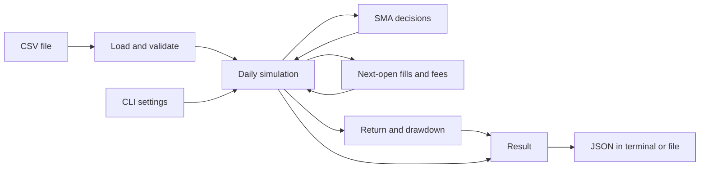

# Clear explanation

## What the program does today

A **backtest** replays historical prices and follows a trading rule. It records
hypothetical purchases, sales, fees, cash, and the value of shares still held.
The Phase 1 engine implements that replay for one asset, one daily price table,
and one set of settings at a time. Phase 2 adds parameter sweeps that run many
independent simulations sequentially or with local worker processes. Phase 3 adds
Ray workers and connections to an existing cluster. The current package release
is `0.4.0`.

You can run the command below and get a JSON result containing the settings,
data fingerprint, trades, order outcomes, daily portfolio values, and summary
metrics. It uses whole shares and USD, and can hold shares or cash. This is
**long-only** trading: it cannot sell borrowed shares or borrow money to buy more.

All three backends can run on one machine. Ray can attach to a cluster, provided
every machine has matching installed code. Actual performance across physical
machines has not been established. Automatic recovery and databases remain
future work. The core uses Python's standard library; Ray and memory sampling
are optional dependencies.

## Python and the tools in simple terms

Python 3.12 or newer runs the program. A **package** is the collection of Python
modules that make up this project. A **virtual environment**, named `.venv` here,
is a project folder containing the Python environment and installed tools.
Activating it makes terminal commands use that environment.

A **CLI**, or command-line interface, accepts commands typed into a terminal.
Use your computer's Terminal app, or open this repository folder in VS Code and
choose **Terminal > New Terminal**. Both run the same program. Enter these
commands at the shell prompt, not inside a Python prompt showing `>>>`.

The commands below use macOS/Linux shell syntax. Start in the repository directory
that contains `pyproject.toml`, `src/`, and `examples/`, then run:

```bash
python3 --version
python3 -m venv .venv
source .venv/bin/activate
python -m pip install --editable ".[dev]"
```

`pip` installs the package. `--editable` lets the installation use the source
under `src/`, so edits there are available without reinstalling each edit.
`[dev]` also installs the development tools. Those tools help check and package
the code; they are not required libraries for the simulation itself.
`python -m ...` asks the selected Python interpreter to run an installed module.
Activate `.venv` again when opening a new terminal. In the examples, a trailing
backslash continues a command on the next line; you can paste the whole block.

| Tool | Job |
| --- | --- |
| pytest | Runs automated examples and checks against expected behavior |
| Ruff | Finds code issues and checks consistent formatting |
| mypy | Checks whether the declared types fit together |
| build and setuptools | Create installable wheel and source-distribution files |
| `pip check` | Checks whether installed package requirements conflict |
| GitHub Actions / CI | Runs configured checks when changes are submitted to GitHub |

These checks address different problems. A successful build establishes that
packaging worked; simulation checks establish the trading rules. Configured CI
also needs an observed run before claiming it passed. See the
[README](../README.md) for the development commands and the
[Phase 1 verification report](phase-1-report.md) for actual verification evidence.

## Run the included example

After setup, run this from the repository directory. The committed
[examples/sma.csv](../examples/sma.csv) is already included; no download is needed:

```bash
python -m distributed_backtester backtest \
  --data examples/sma.csv \
  --symbol SYNTH \
  --price-basis raw \
  --fast 2 --slow 3 \
  --initial-cash 1000 --fee-bps 10 \
  --output artifacts/example.json
```

The installed command `distributed-backtester backtest` accepts the same options.
The module name uses an underscore; the installed command uses a hyphen. You can
also use `.venv/bin/python` in place of `python` to select the project environment
directly without activating it.

| Command or option | Meaning |
| --- | --- |
| `backtest` | Runs one daily SMA simulation |
| `--data examples/sma.csv` | Required path to the input CSV price table |
| `--symbol SYNTH` | Required asset label saved in the result; it does not download or filter prices |
| `--price-basis raw` | Required declaration that prices are unadjusted; `raw` is the only supported choice |
| `--fast 2` | Short moving average uses the latest 2 closes; default is 2 |
| `--slow 3` | Long moving average uses the latest 3 closes; default is 3; both windows must be positive integers and fast must be smaller |
| `--initial-cash 1000` | Starts with $1,000 and no shares; default is 1000; must be positive and exactly representable in millionths of a dollar |
| `--fee-bps 10` | Charges 10 basis points, or 0.1%, of each trade's value; default is 0; accepts integers from 0 through 10000 |
| `--output artifacts/example.json` | Saves JSON to this file, creating parent folders if needed; omit it to print JSON in the terminal |
| `--overwrite` | With `--output`, permits replacing an existing result file; otherwise an existing destination is refused |
| `-h` / `--help` | Shows help; use `python -m distributed_backtester backtest --help` for the options |
| `--version` | Use `python -m distributed_backtester --version` to show the installed package version |

Running the example again with the same output path requires `--overwrite` or a
new destination. The output cannot refer to the input CSV. Invalid settings,
bad data, or file errors produce a nonzero exit and a readable error message.
Invalid data is rejected before a new result is saved.

Once a complete output file has been published, saving has succeeded. If removing
its temporary helper file then fails, the program logs a cleanup warning and
keeps the successful exit status. That warning does not invalidate the result.

## Run four jobs as a parameter sweep

A **job** is one backtest with one set of settings. A **sweep** tries every
combination of the requested fast and slow windows. Here `--fast 1 2` and
`--slow 3 4` create four jobs: `(1, 3)`, `(1, 4)`, `(2, 3)`, and `(2, 4)`.
All use the same included prices, starting cash, and fees.

First run them sequentially, one job at a time:

```bash
python -m distributed_backtester sweep \
  --data examples/sma.csv --symbol SYNTH --price-basis raw \
  --fast 1 2 --slow 3 4 --initial-cash 1000 --fee-bps 10 \
  --backend sequential --workers 1 \
  --output-dir artifacts/sweep-sequential
```

Then run the same four jobs with two worker processes:

```bash
python -m distributed_backtester sweep \
  --data examples/sma.csv --symbol SYNTH --price-basis raw \
  --fast 1 2 --slow 3 4 --initial-cash 1000 --fee-bps 10 \
  --backend process --workers 2 --max-in-flight 4 \
  --output-dir artifacts/sweep-process
```

`--backend` chooses how jobs run; it does not change their trading rules.
`--workers 2` allows two separate Python processes to calculate jobs. Each worker
receives its own immutable copy of the prices once and reuses it for later jobs.
This is not shared memory. For the process backend, `--max-in-flight` caps the
submitted jobs whose outcomes have not yet been consumed, including completed
results waiting to be saved. Its default is twice the worker count, so two
workers default to four. The sequential backend requires one worker and does
not accept this option. Use `python -m distributed_backtester sweep --help`
for the sweep options.

Each sweep prints a short JSON summary with `submitted`, `succeeded`, and
`failed` counts plus file paths. Open the output folder in VS Code to inspect:

| File | What it tells you |
| --- | --- |
| `manifest.json` | Dataset and code fingerprints, unique job settings, and the requested grid membership |
| `results/<job_id>.json` | One job's settings and detailed trading result, or a structured failure |
| `index.json` | Final counts and a compact list sorted by job ID, with metrics, artifact paths, and content fingerprints |
| `execution.json` | Backend, workers, pending-work limit, elapsed time, source path, and environment information |

A **fingerprint** is a hash identifying exact content. Job IDs depend on the data,
settings, and installed implementation. Given the same inputs and code, the
manifest, detailed results, and index are identical across these backends.
Execution details are stored separately because workers and timings can differ.

Repeated settings collapse to one job. For example, `--fast 1 2 1 --slow 3 4`
requests six grid entries but executes four unique jobs; the manifest retains all
six entries. Every pair must have positive windows with fast smaller than slow.
An invalid pair, such as `(3, 3)`, rejects the whole request before creating an
output directory; it is not silently skipped.

The output directory must be new, even if an existing directory is empty. Do not
create it in advance. To run again, choose another name such as
`artifacts/sweep-process-2`. Sweeps have no `--overwrite` option.

| Sweep exit code | Meaning |
| --- | --- |
| `0` | All unique jobs succeeded and the index was finalized |
| `1` | Collection completed, but at least one job has a recorded failure; the index includes those failures |
| `2` | Invalid arguments/data, an existing destination, or a reported fatal backend/export error |

After a command, `echo $?` shows its exit code in this shell. Ordinary job
exceptions become failure records so other jobs can finish. A broken worker
pool, invalid backend output, or export failure aborts collection. Partial files
may remain, but no final `index.json` is published for an incomplete sweep.
Phase 2 has no automatic retries or recovery; those are planned for Phase 4.

## What the trading rule means

A **simple moving average**, or **SMA**, is the average of the most recent chosen
number of closing prices. Every price in that window has equal weight. The rule
compares a short average with a longer one.

The strategy starts with a target of cash, called `flat`. With fast 2 and slow 3,
the first two closes are **warm-up**: there are too few prices for the longer
average, so no order is requested. At the third close, a higher fast average
requests shares, called `invested`. It can enter on that first ready positive
comparison; it does not need an earlier comparison that was negative.

A lower fast average requests cash. Equal averages preserve the previous target.
An order is requested only when the target changes. Staying invested does not
buy more or rebalance every day. If cash cannot afford even one share including
the fee, the entry is recorded as rejected. The built-in strategy does not retry
it merely because the price later becomes cheaper; it needs a new target change.

## When information becomes available

A daily row contains the **open**, **high**, **low**, **close**, and **volume**.
The strategy receives only completed dates and closing prices through the current
session, together with the current cash and shares. It cannot use future rows
through the supported strategy interface.

Each session follows this order:

```text
Open:  fill the previous close's pending order, if any.
Close: record cash + shares × closing price as portfolio equity.
Then:  let the strategy decide a target for the next supplied session's open.
```

A signal at January 6's close cannot fill at January 6's open or close. The first
possible fill is January 7's open. Using information from a completed close to
invent an earlier fill would be **lookahead bias**.

The first row has no pending order. An order requested on the last row is canceled
because there is no next open. Shares still held at the end are valued at the
final close; the program does not invent a sale or charge a final sale fee.
"Next session" means the next supplied row. The program has no exchange calendar
to detect an accidentally omitted trading session.

## Follow every step of the actual example

[examples/sma.csv](../examples/sma.csv) has five sessions in January 2026. With
fast 2, slow 3, $1,000 starting cash, and 10 bps fees, the ledger is:

| Session | Open | Close | Fill at the open | Decision after the close | Cash after fill | Shares | Close equity |
| --- | --- | --- | --- | --- | --- | --- | --- |
| Jan 02 | $10 | $10 | None | Warm-up | $1,000.000000 | 0 | $1,000.000000 |
| Jan 05 | $11 | $11 | None | Warm-up | $1,000.000000 | 0 | $1,000.000000 |
| Jan 06 | $12 | $12 | None | Request invested | $1,000.000000 | 0 | $1,000.000000 |
| Jan 07 | $12 | $9 | Buy 83 shares; fee $0.996000 | Request flat | $3.004000 | 83 | $750.004000 |
| Jan 08 | $9 | $9 | Sell 83 shares; fee $0.747000 | Remain flat | $749.257000 | 0 | $749.257000 |

At January 6's close, the fast average is `(11 + 12) / 2 = 11.5`; the slow
average is `(10 + 11 + 12) / 3 = 11`. That first ready positive comparison
requests a buy for January 7's open.

At that $12 open, 83 shares cost $996. The fee is $996 × 0.001 = $0.996, so
cash becomes `$1000 - $996 - $0.996 = $3.004`. Buying 84 would require
$1,009.008 including the fee, more than the available cash. At the $9 close,
equity is `$3.004 + 83 × $9 = $750.004`.

After January 7's close, the fast average is `(12 + 9) / 2 = 10.5`; the slow
average is `(11 + 12 + 9) / 3 = 10⅔`. The lower fast average requests a sale.
At January 8's $9 open, the 83 shares sell for $747, with a $0.747 fee.
Cash becomes `$3.004 + $747 - $0.747 = $749.257`. Its fast average is then 9
and its slow average is 10, so the target stays flat and no new order is emitted.

## Read the result correctly

**Equity** means cash plus the current value of shares. **Total return** compares
final equity with starting cash. **Maximum drawdown** is the largest fall from
the highest equity reached so far, including the starting cash as an initial
reference point.

For this example, the JSON metrics section is:

```json
{
  "fill_count": 2,
  "final_equity": "749.257000",
  "maximum_drawdown": "0.250743000000",
  "total_fees": "1.743000",
  "total_return": "-0.250743000000"
}
```

Return and drawdown are **decimal ratios**, not percentages. Multiply by 100 to
read them as -25.0743% return and 25.0743% maximum drawdown. `fill_count` counts
executed trades: one buy plus one sell is two fills. It is not two completed
round trips.

The strategy loses money because it buys at $12 and sells at $9, then pays fees.
The price loss is `83 × ($9 - $12) = -$249`; fees total $1.743, giving a
$250.743 loss. This agrees with the recorded cash. A loss is not a software
failure: correctness means following the stated rules and reconciling the ledger.
This synthetic example demonstrates those rules, not future profitability.

Inside the program, $1 equals 1,000,000 integer **micro-dollars**. Prices, cash,
trade values, fees, and equity use these units to avoid binary floating-point
rounding drift. Fees round once per fill to the nearest micro-dollar, with exact
ties going to the even integer. JSON money values are strings with six decimal
places; ratios have twelve places. This fee model does not claim to match every
broker's cent rounding, minimum fees, or other charges.

## The implemented pieces



These are modules and functions inside one package. The loader checks the price
table. The strategy chooses a target. The engine orders events. Execution changes
cash and shares. Metrics summarize the recorded equity. The CLI handles files and
options around the calculation.

For a sweep, the experiment manager creates jobs and a backend calls this same
engine for each one. Detailed results are saved as they finish. Only job
definitions and compact index records remain for the whole sweep; those still
grow with the number of jobs, and each full result grows with its price-row count.

Python callers can also supply a strategy object. A supplied built-in SMA must
use the same windows as the backtest settings and start with fresh or reset state.
Other custom strategy hooks can run in memory for reference checks, but their
results cannot be exported as semantic JSON without supported strategy provenance.
That future design must describe their identity, parameters, and state well enough
to reproduce them. The current CLI runs and exports the built-in SMA.

## Data assumptions and current limits

The CSV must contain exactly `date,open,high,low,close,volume`, with no extra,
missing, or duplicate column names; their order may vary. Dates must be valid
`YYYY-MM-DD` labels in strictly increasing order. Prices must be positive, finite,
and exactly representable in micro-dollars; high and low must contain both open and close.
Volume must be a nonnegative whole number. Empty data, blank rows or fields, and
malformed rows are rejected. The loader does not sort, fill gaps, or drop bad rows.

`--price-basis raw` declares unadjusted prices. Numeric checks cannot prove that
declaration or detect every corporate action. For real data, the caller must
establish that the supplied interval has no splits or dividends and contains the
intended sessions. Mixing adjusted closes with raw opens does not fit this model.

The engine has no intraday trading, fractional shares, short selling, leverage,
corporate-action accounting, spreads, slippage, partial fills, or volume limits.
It assumes a full fill at the next supplied open if cash permits. It does not
download market data or establish that a historical stock selection avoids
survivorship bias. Local JSON saving protects complete-file publication and
refuses accidental overwrite by default; it is not a crash-recovery service.

## Run a benchmark without assuming a speedup

A benchmark runs a declared workload repeatedly to compare execution time and
memory. Install the optional measurement tools, which pin `psutil` to `7.2.2`:

```bash
python -m pip install --editable ".[benchmark]"
python -m distributed_backtester.benchmark run \
  --bars 1000 --jobs 16 --workers 2 4 8 --repetitions 5 \
  --output-dir artifacts/benchmark-example
```

The bar and job counts here are illustrative inputs, not measured results or
the final report's chosen workloads. The runner generates deterministic synthetic
prices and distinct job settings. It includes a sequential baseline, one warm-up
per configuration, then five repetitions with rotating configuration order.
Choose worker counts supported by your machine; counts above available cores are
rejected. Use a new output directory for each benchmark.

Each trial starts a fresh process. Timing includes startup, imports, loading,
worker creation, calculation, result export, finalization, and shutdown. Dataset
generation and output verification after the trial are outside that timing.
The runner checks each result file's fingerprint and verifies equal semantic
output digests across trials before producing a comparison report.

Raw observations are retained. Memory sampling uses a nominal 50 ms interval and
sums the coordinator's and live descendants' RSS, a measure of resident memory,
within each sampling round. These readings are approximately aligned and can miss brief
peaks or count shared pages more than once; the sum is not unique physical memory.
The operating system's file cache is uncontrolled even though processes are new.
Worker counts alone do not establish faster execution.

The [Phase 2 report](phase-2-report.md) and
[benchmark results](benchmarks/phase-2/results.md) record verification and
actual measurements. See the [benchmark methodology](benchmarking.md) for the
measurement definitions.

## Phase 3: Ray in simple terms

Ray helps a Python program send work to other processes, including processes on
other machines. A **cluster** is the group of machines or worker nodes available
to Ray. The **driver** is your command-line program coordinating the experiment.
An **actor** is a worker process that stays alive and handles several jobs.

Think of a driver distributing worksheets to two assistants. Both assistants
receive the same price history once. Each worksheet has different moving-average
settings. The assistants calculate independently, and the driver saves their
answers. A new strategy is created for every worksheet, so one job's holdings or
signals cannot carry into the next.

Use Terminal, from the project directory, with your environment activated:

```bash
python -m pip install --editable ".[dev,benchmark,distributed]"
distributed-backtester sweep --data examples/sma.csv --symbol SYNTH \
  --price-basis raw --fast 1 2 --slow 3 4 --fee-bps 10 \
  --backend ray --workers 2 --output-dir artifacts/my-ray-sweep
python -m json.tool artifacts/my-ray-sweep/index.json
```

The example CSV is included. This command runs four combinations using two Ray
workers. Pick a new output directory when repeating it. Ray starts and stops its
local cluster automatically. You do not need a website, dashboard, or cloud
account. The interface is the same CLI you already used in Phase 1 and Phase 2.

To check correctness, run the same sweep with `--backend sequential` and
`--backend process --workers 2`, each in a new directory. Their manifest, detailed
answers, and final index must agree byte for byte. `execution.json` will differ
because it describes how each run happened. Automated tests check this as well:

```bash
python -m pytest tests/test_ray_backend.py tests/test_ray_cli.py
```

`--max-in-flight` limits how many submitted answers are waiting to be collected.
`--cpus-per-worker` tells Ray how much CPU capacity to reserve per assistant; it
does not make one simulation use several CPU cores. Most beginners should use
the default value of 1. Ray's object store holds a transferable dataset, but each
assistant still builds its own Python data objects from it.

More workers can take longer for small jobs because starting workers, scheduling,
moving data, and saving answers all cost time. The local Ray benchmark measures
those costs. It starts a new cluster for every measured Ray run, so its timing
includes startup and shutdown. It cannot tell you how fast a prestarted cluster
or a different group of physical machines will be.

An existing cluster uses `--ray-address HOST:PORT`. The command stops only its own
actors and disconnects afterward, leaving that cluster running. Setup and matching
package requirements are in [Ray cluster instructions](ray-clusters.md).

If a strategy raises an ordinary error, that job gets an explicit failed answer.
If a Ray worker or infrastructure fails, the experiment can stop with partial
files and no final index. There are no automatic retries or resume yet. That is
the next phase and requires your approval.

### What our measurements showed

On the measured Mac, 64 backtests with 4,096 price bars each took a median of
**2.013 seconds sequentially**, **1.374 seconds with two processes**, and
**5.371 seconds with two Ray actors**. These include startup, saving results,
and shutdown. Ray took longer for these workloads. A cluster already running
would need a separate benchmark.

All 56 trials and warmups produced matching answers for their workload. We could
not measure complete private memory: macOS denied child memory reads, and some
actor processes could not be safely associated with the experiment by our
observer. Missing readings stay marked unavailable. Read the
[results](benchmarks/phase-3/results.md) and [completion report](phase-3-report.md)
for the evidence and limitations.

## What is planned next

| Phase | Planned capability |
| --- | --- |
| 4 | A single coordinator's durable job tracking, bounded retries, and at most one committed success per job ID, even if calculation repeats |
| 5 | Parquet data and DuckDB analysis, comparing economic results while checking each format's provenance separately |
| 6 | Profiling and optimizations supported by measured results |
| 7 | Operational tooling and a reproducible developer environment |
| 8 | Final documentation and portfolio evidence based on implemented facts |

Those later features are not part of the implemented Phase 3 scope. Planned
Phase 4 recovery does not promise coordinator high availability or recovery after
disk loss. Several workers may be slower for small jobs, so scaling claims need
actual measurements.

Read the [technical explanation](technical-explanation.md) for the exact module
interfaces and guarantees, the [Phase 1 plan](phase-1-plan.md) for the accepted
engine scope, the [Phase 2 plan](phase-2-plan.md) for the local sweep design,
[architecture](architecture.md) for module relationships, and the
[roadmap](roadmap.md) for later phase checkpoints.
