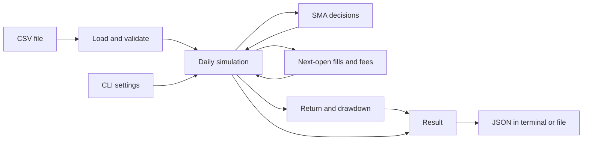
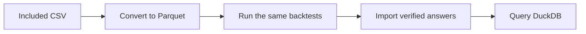

# Clear explanation

## What the program does today

A **backtest** replays historical prices and follows a trading rule. It records
hypothetical purchases, sales, fees, cash, and the value of shares still held.
The Phase 1 engine implements that replay for one asset, one daily price table,
and one set of settings at a time. Phase 2 adds parameter sweeps that run many
independent simulations sequentially or with local worker processes. Phase 3 adds
Ray workers and connections to an existing cluster. The package version
is `0.8.0`, with **Phase 7 complete**. Phase 8 has not been approved.

You can run the command below and get a JSON result containing the settings,
data fingerprint, trades, order outcomes, daily portfolio values, and summary
metrics. It uses whole shares and USD, and can hold shares or cash. This is
**long-only** trading: it cannot sell borrowed shares or borrow money to buy more.

All three backends can run on one machine. Ray can attach to a cluster, provided
every machine has matching installed code. Actual performance across physical
machines has not been established. Phase 4 adds optional recovery using a local SQLite journal. The core uses Python's standard library; Ray and memory sampling
are optional dependencies. Phase 5 adds optional Parquet data files and a DuckDB
database for searching complete answers. The original CSV example still works.
Phase 6 adds profiling and reviewed Python optimizations. Phase 7 adds TOML
settings files, optional progress logs, validated status, interruption handling,
and Docker packaging around the same command-line program. Native, installed-wheel
and Linux ARM64 container release checks passed. The
[Phase 7 report](phase-7-report.md) records those checks and their limits; this
guide makes no new speed or memory claim.

## Python and the tools in simple terms

Python 3.12 or newer runs the program. A **package** is the collection of Python
modules that make up this project. A **virtual environment**, named `.venv` here,
is a project folder containing the Python environment and installed tools.
Activating it makes terminal commands use that environment.

A **CLI**, or command-line interface, accepts commands typed into a terminal.
Use your computer's Terminal app, or open this repository folder in VS Code and
choose **Terminal > New Terminal**. Both run the same program. Enter these
commands at the shell prompt, not inside a Python prompt showing `>>>`.

The commands below use macOS/Linux shell syntax. Start in the repository directory
that contains `pyproject.toml`, `src/`, and `examples/`, then run:

```bash
python3 --version
python3 -m venv .venv
source .venv/bin/activate
python -m pip install --editable ".[dev]"
```

`pip` installs the package. `--editable` lets the installation use the source
under `src/`, so edits there are available without reinstalling each edit.
`[dev]` also installs the development tools. Those tools help check and package
the code; they are not required libraries for the simulation itself.
`python -m ...` asks the selected Python interpreter to run an installed module.
Activate `.venv` again when opening a new terminal. In the examples, a trailing
backslash continues a command on the next line; you can paste the whole block.

| Tool | Job |
| --- | --- |
| pytest | Runs automated examples and checks against expected behavior |
| Ruff | Finds code issues and checks consistent formatting |
| mypy | Checks whether the declared types fit together |
| build and setuptools | Create installable wheel and source-distribution files |
| `pip check` | Checks whether installed package requirements conflict |
| GitHub Actions / CI | Runs configured checks when changes are submitted to GitHub |

These checks address different problems. A successful build establishes that
packaging worked; simulation checks establish the trading rules. Configured CI
also needs an observed run before claiming it passed. See the
[README](../README.md) for the development commands and the
[Phase 1 verification report](phase-1-report.md) for actual verification evidence.

## Run the included example

After setup, run this from the repository directory. The committed
[examples/sma.csv](../examples/sma.csv) is already included; no download is needed:

```bash
python -m distributed_backtester backtest \
  --data examples/sma.csv \
  --symbol SYNTH \
  --price-basis raw \
  --fast 2 --slow 3 \
  --initial-cash 1000 --fee-bps 10 \
  --output artifacts/example.json
```

The installed command `distributed-backtester backtest` accepts the same options.
The module name uses an underscore; the installed command uses a hyphen. You can
also use `.venv/bin/python` in place of `python` to select the project environment
directly without activating it.

| Command or option | Meaning |
| --- | --- |
| `backtest` | Runs one daily SMA simulation |
| `--data examples/sma.csv` | Required path to the input CSV price table |
| `--symbol SYNTH` | Required asset label saved in the result; it does not download or filter prices |
| `--price-basis raw` | Required declaration that prices are unadjusted; `raw` is the only supported choice |
| `--fast 2` | Short moving average uses the latest 2 closes; default is 2 |
| `--slow 3` | Long moving average uses the latest 3 closes; default is 3; both windows must be positive integers and fast must be smaller |
| `--initial-cash 1000` | Starts with $1,000 and no shares; default is 1000; must be positive and exactly representable in millionths of a dollar |
| `--fee-bps 10` | Charges 10 basis points, or 0.1%, of each trade's value; default is 0; accepts integers from 0 through 10000 |
| `--output artifacts/example.json` | Saves JSON to this file, creating parent folders if needed; omit it to print JSON in the terminal |
| `--overwrite` | With `--output`, permits replacing an existing result file; otherwise an existing destination is refused |
| `-h` / `--help` | Shows help; use `python -m distributed_backtester backtest --help` for the options |
| `--version` | Use `python -m distributed_backtester --version` to show the installed package version |

Running the example again with the same output path requires `--overwrite` or a
new destination. The output cannot refer to the input CSV. Invalid settings,
bad data, or file errors produce a nonzero exit and a readable error message.
Invalid data is rejected before a new result is saved.

Once a complete output file has been published, saving has succeeded. If removing
its temporary helper file then fails, the program logs a cleanup warning and
keeps the successful exit status. That warning does not invalidate the result.

## Run four jobs as a parameter sweep

A **job** is one backtest with one set of settings. A **sweep** tries every
combination of the requested fast and slow windows. Here `--fast 1 2` and
`--slow 3 4` create four jobs: `(1, 3)`, `(1, 4)`, `(2, 3)`, and `(2, 4)`.
All use the same included prices, starting cash, and fees.

First run them sequentially, one job at a time:

```bash
python -m distributed_backtester sweep \
  --data examples/sma.csv --symbol SYNTH --price-basis raw \
  --fast 1 2 --slow 3 4 --initial-cash 1000 --fee-bps 10 \
  --backend sequential --workers 1 \
  --output-dir artifacts/sweep-sequential
```

Then run the same four jobs with two worker processes:

```bash
python -m distributed_backtester sweep \
  --data examples/sma.csv --symbol SYNTH --price-basis raw \
  --fast 1 2 --slow 3 4 --initial-cash 1000 --fee-bps 10 \
  --backend process --workers 2 --max-in-flight 4 \
  --output-dir artifacts/sweep-process
```

`--backend` chooses how jobs run; it does not change their trading rules.
`--workers 2` allows two separate Python processes to calculate jobs. Each worker
receives its own immutable copy of the prices once and reuses it for later jobs.
This is not shared memory. For the process backend, `--max-in-flight` caps the
submitted jobs whose outcomes have not yet been consumed, including completed
results waiting to be saved. Its default is twice the worker count, so two
workers default to four. The sequential backend requires one worker and does
not accept this option. Use `python -m distributed_backtester sweep --help`
for the sweep options.

Each sweep prints a short JSON summary with `submitted`, `succeeded`, and
`failed` counts plus file paths. Open the output folder in VS Code to inspect:

| File | What it tells you |
| --- | --- |
| `manifest.json` | Dataset and code fingerprints, unique job settings, and the requested grid membership |
| `results/<job_id>.json` | One job's settings and detailed trading result, or a structured failure |
| `index.json` | Final counts and a compact list sorted by job ID, with metrics, artifact paths, and content fingerprints |
| `execution.json` | Backend, workers, pending-work limit, elapsed time, source path, and environment information |

A **fingerprint** is a hash identifying exact content. Job IDs depend on the data,
settings, and installed implementation. Given the same inputs and code, the
manifest, detailed results, and index are identical across these backends.
Execution details are stored separately because workers and timings can differ.

Repeated settings collapse to one job. For example, `--fast 1 2 1 --slow 3 4`
requests six grid entries but executes four unique jobs; the manifest retains all
six entries. Every pair must have positive windows with fast smaller than slow.
An invalid pair, such as `(3, 3)`, rejects the whole request before creating an
output directory; it is not silently skipped.

The output directory must be new, even if an existing directory is empty. Do not
create it in advance. To run again, choose another name such as
`artifacts/sweep-process-2`. Sweeps have no `--overwrite` option.

| Sweep exit code | Meaning |
| --- | --- |
| `0` | All unique jobs succeeded and the index was finalized |
| `1` | Collection completed, but at least one job has a recorded failure; the index includes those failures |
| `2` | Invalid arguments/data, an existing destination, or a reported fatal backend/export error |

After a command, `echo $?` shows its exit code in this shell. Ordinary job
exceptions become failure records so other jobs can finish. A broken worker
pool, invalid backend output, or export failure aborts collection. Partial files
may remain, but no final `index.json` is published for an incomplete sweep.
Classic sweeps have no automatic retries or recovery. Use the durable Ray mode
for the Phase 4 recovery features.

## What the trading rule means

A **simple moving average**, or **SMA**, is the average of the most recent chosen
number of closing prices. Every price in that window has equal weight. The rule
compares a short average with a longer one.

The strategy starts with a target of cash, called `flat`. With fast 2 and slow 3,
the first two closes are **warm-up**: there are too few prices for the longer
average, so no order is requested. At the third close, a higher fast average
requests shares, called `invested`. It can enter on that first ready positive
comparison; it does not need an earlier comparison that was negative.

A lower fast average requests cash. Equal averages preserve the previous target.
An order is requested only when the target changes. Staying invested does not
buy more or rebalance every day. If cash cannot afford even one share including
the fee, the entry is recorded as rejected. The built-in strategy does not retry
it merely because the price later becomes cheaper; it needs a new target change.

## When information becomes available

A daily row contains the **open**, **high**, **low**, **close**, and **volume**.
The strategy receives only completed dates and closing prices through the current
session, together with the current cash and shares. It cannot use future rows
through the supported strategy interface.

Each session follows this order:

```text
Open:  fill the previous close's pending order, if any.
Close: record cash + shares × closing price as portfolio equity.
Then:  let the strategy decide a target for the next supplied session's open.
```

A signal at January 6's close cannot fill at January 6's open or close. The first
possible fill is January 7's open. Using information from a completed close to
invent an earlier fill would be **lookahead bias**.

The first row has no pending order. An order requested on the last row is canceled
because there is no next open. Shares still held at the end are valued at the
final close; the program does not invent a sale or charge a final sale fee.
"Next session" means the next supplied row. The program has no exchange calendar
to detect an accidentally omitted trading session.

## Follow every step of the actual example

[examples/sma.csv](../examples/sma.csv) has five sessions in January 2026. With
fast 2, slow 3, $1,000 starting cash, and 10 bps fees, the ledger is:

| Session | Open | Close | Fill at the open | Decision after the close | Cash after fill | Shares | Close equity |
| --- | --- | --- | --- | --- | --- | --- | --- |
| Jan 02 | $10 | $10 | None | Warm-up | $1,000.000000 | 0 | $1,000.000000 |
| Jan 05 | $11 | $11 | None | Warm-up | $1,000.000000 | 0 | $1,000.000000 |
| Jan 06 | $12 | $12 | None | Request invested | $1,000.000000 | 0 | $1,000.000000 |
| Jan 07 | $12 | $9 | Buy 83 shares; fee $0.996000 | Request flat | $3.004000 | 83 | $750.004000 |
| Jan 08 | $9 | $9 | Sell 83 shares; fee $0.747000 | Remain flat | $749.257000 | 0 | $749.257000 |

At January 6's close, the fast average is `(11 + 12) / 2 = 11.5`; the slow
average is `(10 + 11 + 12) / 3 = 11`. That first ready positive comparison
requests a buy for January 7's open.

At that $12 open, 83 shares cost $996. The fee is $996 × 0.001 = $0.996, so
cash becomes `$1000 - $996 - $0.996 = $3.004`. Buying 84 would require
$1,009.008 including the fee, more than the available cash. At the $9 close,
equity is `$3.004 + 83 × $9 = $750.004`.

After January 7's close, the fast average is `(12 + 9) / 2 = 10.5`; the slow
average is `(11 + 12 + 9) / 3 = 10⅔`. The lower fast average requests a sale.
At January 8's $9 open, the 83 shares sell for $747, with a $0.747 fee.
Cash becomes `$3.004 + $747 - $0.747 = $749.257`. Its fast average is then 9
and its slow average is 10, so the target stays flat and no new order is emitted.

## Read the result correctly

**Equity** means cash plus the current value of shares. **Total return** compares
final equity with starting cash. **Maximum drawdown** is the largest fall from
the highest equity reached so far, including the starting cash as an initial
reference point.

For this example, the JSON metrics section is:

```json
{
  "fill_count": 2,
  "final_equity": "749.257000",
  "maximum_drawdown": "0.250743000000",
  "total_fees": "1.743000",
  "total_return": "-0.250743000000"
}
```

Return and drawdown are **decimal ratios**, not percentages. Multiply by 100 to
read them as -25.0743% return and 25.0743% maximum drawdown. `fill_count` counts
executed trades: one buy plus one sell is two fills. It is not two completed
round trips.

The strategy loses money because it buys at $12 and sells at $9, then pays fees.
The price loss is `83 × ($9 - $12) = -$249`; fees total $1.743, giving a
$250.743 loss. This agrees with the recorded cash. A loss is not a software
failure: correctness means following the stated rules and reconciling the ledger.
This synthetic example demonstrates those rules, not future profitability.

Inside the program, $1 equals 1,000,000 integer **micro-dollars**. Prices, cash,
trade values, fees, and equity use these units to avoid binary floating-point
rounding drift. Fees round once per fill to the nearest micro-dollar, with exact
ties going to the even integer. JSON money values are strings with six decimal
places; ratios have twelve places. This fee model does not claim to match every
broker's cent rounding, minimum fees, or other charges.

## The implemented pieces



These are modules and functions inside one package. The loader checks the price
table. The strategy chooses a target. The engine orders events. Execution changes
cash and shares. Metrics summarize the recorded equity. The CLI handles files and
options around the calculation.

For a sweep, the experiment manager creates jobs and a backend calls this same
engine for each one. Detailed results are saved as they finish. Only job
definitions and compact index records remain for the whole sweep; those still
grow with the number of jobs, and each full result grows with its price-row count.

Python callers can also supply a strategy object. A supplied built-in SMA must
use the same windows as the backtest settings and start with fresh or reset state.
Other custom strategy hooks can run in memory for reference checks, but their
results cannot be exported as semantic JSON without supported strategy provenance.
That future design must describe their identity, parameters, and state well enough
to reproduce them. The current CLI runs and exports the built-in SMA.

## Data assumptions and current limits

The CSV must contain exactly `date,open,high,low,close,volume`, with no extra,
missing, or duplicate column names; their order may vary. Dates must be valid
`YYYY-MM-DD` labels in strictly increasing order. Prices must be positive, finite,
and exactly representable in micro-dollars; high and low must contain both open and close.
Volume must be a nonnegative whole number. Empty data, blank rows or fields, and
malformed rows are rejected. The loader does not sort, fill gaps, or drop bad rows.

`--price-basis raw` declares unadjusted prices. Numeric checks cannot prove that
declaration or detect every corporate action. For real data, the caller must
establish that the supplied interval has no splits or dividends and contains the
intended sessions. Mixing adjusted closes with raw opens does not fit this model.

The engine has no intraday trading, fractional shares, short selling, leverage,
corporate-action accounting, spreads, slippage, partial fills, or volume limits.
It assumes a full fill at the next supplied open if cash permits. It does not
download market data or establish that a historical stock selection avoids
survivorship bias. Local JSON saving protects complete-file publication and
refuses accidental overwrite by default; it is not a crash-recovery service.

## Run a benchmark without assuming a speedup

A benchmark runs a declared workload repeatedly to compare execution time and
memory. Install the optional measurement tools, which pin `psutil` to `7.2.2`:

```bash
python -m pip install --editable ".[benchmark]"
python -m distributed_backtester.benchmark run \
  --bars 1000 --jobs 16 --workers 2 4 8 --repetitions 5 \
  --output-dir artifacts/benchmark-example
```

The bar and job counts here are illustrative inputs, not measured results or
the final report's chosen workloads. The runner generates deterministic synthetic
prices and distinct job settings. It includes a sequential baseline, one warm-up
per configuration, then five repetitions with rotating configuration order.
Choose worker counts supported by your machine; counts above available cores are
rejected. Use a new output directory for each benchmark.

Each trial starts a fresh process. Timing includes startup, imports, loading,
worker creation, calculation, result export, finalization, and shutdown. Dataset
generation and output verification after the trial are outside that timing.
The runner checks each result file's fingerprint and verifies equal semantic
output digests across trials before producing a comparison report.

Raw observations are retained. Memory sampling uses a nominal 50 ms interval and
sums the coordinator's and live descendants' RSS, a measure of resident memory,
within each sampling round. These readings are approximately aligned and can miss brief
peaks or count shared pages more than once; the sum is not unique physical memory.
The operating system's file cache is uncontrolled even though processes are new.
Worker counts alone do not establish faster execution.

The [Phase 2 report](phase-2-report.md) and
[benchmark results](benchmarks/phase-2/results.md) record verification and
actual measurements. See the [benchmark methodology](benchmarking.md) for the
measurement definitions.

## Phase 3: Ray in simple terms

Ray helps a Python program send work to other processes, including processes on
other machines. A **cluster** is the group of machines or worker nodes available
to Ray. The **driver** is your command-line program coordinating the experiment.
An **actor** is a worker process that stays alive and handles several jobs.

Think of a driver distributing worksheets to two assistants. Both assistants
receive the same price history once. Each worksheet has different moving-average
settings. The assistants calculate independently, and the driver saves their
answers. A new strategy is created for every worksheet, so one job's holdings or
signals cannot carry into the next.

Use Terminal, from the project directory, with your environment activated:

```bash
python -m pip install --editable ".[dev,benchmark,distributed]"
distributed-backtester sweep --data examples/sma.csv --symbol SYNTH \
  --price-basis raw --fast 1 2 --slow 3 4 --fee-bps 10 \
  --backend ray --workers 2 --output-dir artifacts/my-ray-sweep
python -m json.tool artifacts/my-ray-sweep/index.json
```

The example CSV is included. This command runs four combinations using two Ray
workers. Pick a new output directory when repeating it. Ray starts and stops its
local cluster automatically. You do not need a website, dashboard, or cloud
account. The interface is the same CLI you already used in Phase 1 and Phase 2.

To check correctness, run the same sweep with `--backend sequential` and
`--backend process --workers 2`, each in a new directory. Their manifest, detailed
answers, and final index must agree byte for byte. `execution.json` will differ
because it describes how each run happened. Automated tests check this as well:

```bash
python -m pytest tests/test_ray_backend.py tests/test_ray_cli.py
```

`--max-in-flight` limits how many submitted answers are waiting to be collected.
`--cpus-per-worker` tells Ray how much CPU capacity to reserve per assistant; it
does not make one simulation use several CPU cores. Most beginners should use
the default value of 1. Ray's object store holds a transferable dataset, but each
assistant still builds its own Python data objects from it.

More workers can take longer for small jobs because starting workers, scheduling,
moving data, and saving answers all cost time. The local Ray benchmark measures
those costs. It starts a new cluster for every measured Ray run, so its timing
includes startup and shutdown. It cannot tell you how fast a prestarted cluster
or a different group of physical machines will be.

An existing cluster uses `--ray-address HOST:PORT`. The command stops only its own
actors and disconnects afterward, leaving that cluster running. Setup and matching
package requirements are in [Ray cluster instructions](ray-clusters.md).

If a strategy raises an ordinary error, that job gets an explicit failed answer.
If a Ray worker or infrastructure fails, the experiment can stop with partial
files and no final index in classic mode. The Phase 4 durable mode below adds
bounded retries and resume.

### What our measurements showed

On the measured Mac, 64 backtests with 4,096 price bars each took a median of
**2.013 seconds sequentially**, **1.374 seconds with two processes**, and
**5.371 seconds with two Ray actors**. These include startup, saving results,
and shutdown. Ray took longer for these workloads. A cluster already running
would need a separate benchmark.

All 56 trials and warmups produced matching answers for their workload. We could
not measure complete private memory: macOS denied child memory reads, and some
actor processes could not be safely associated with the experiment by our
observer. Missing readings stay marked unavailable. Read the
[results](benchmarks/phase-3/results.md) and [completion report](phase-3-report.md)
for the evidence and limitations.

## What is planned next

| Phase | Capability and current status |
| --- | --- |
| 7 | Operational tooling and an installed Docker environment; complete with native and Linux ARM64 verification |
| 8 | Final documentation and portfolio evidence based on implemented facts; unapproved |

Phase 6 profiling and reviewed Python optimizations are available; the final
backend comparison is verified. Those are historical Phase 6 results from the
archived `0.7.0` source. Phase 7 has its own [verification report](phase-7-report.md), and Phase 8
requires explicit approval. Phase 4 recovery does not promise coordinator high
availability or recovery after disk loss. Several workers may be slower for small jobs, so
scaling claims need actual measurements.

Read the [technical explanation](technical-explanation.md) for the exact module
interfaces and guarantees, the [Phase 1 plan](phase-1-plan.md) for the accepted
engine scope, the [Phase 2 plan](phase-2-plan.md) for the local sweep design,
[architecture](architecture.md) for module relationships, and the
[roadmap](roadmap.md) for later phase checkpoints.


## Phase 4: recovering work when a process stops

Imagine running 1,000 simulations. If the program stops after 700 finish, you want
to keep those 700 results. A **journal** is a saved record of completed work and
unfinished work. This project uses SQLite, a database stored in files on your
computer, to hold that record.

| Word | Simple meaning |
| --- | --- |
| Job | One simulation with one set of settings |
| Attempt | One try at running that job |
| Retry | Another try after an attempt fails |
| Timeout | A time limit for receiving an attempt's result |
| Commit | Saving a complete result and marking its job finished together |
| Idempotent commit | Receiving the same result again does not save another copy |
| Lease | Permission for one particular attempt to finish a job |
| Generation | The coordinator session number, used to reject old permissions |

The coordinator saves an attempt before sending it to Ray. The worker calculates
its result; only the coordinator saves the authoritative result. If a worker dies,
the coordinator can retry. If the coordinator dies, `resume` reads the saved journal.
An interrupted attempt still uses one try from the retry budget.

The default limit is **three attempts total**, including the first try. That means
up to two retries. A job that keeps failing becomes a clearly reported failed job.
A worker may finish and lose its reply; the program might calculate it again.
This is why we promise one saved terminal result per job, not one calculation.

JSON result files are copies for you to inspect. The journal is the master record.
Resume can recreate those copies even when every job is already finished, without
starting Ray again. Keep your input dataset outside the experiment output directory.
Do not edit or delete SQLite working files while an experiment is running.

Use Terminal or VS Code's terminal. Install the optional Ray extra, then copy the
[durable command examples](reliability.md#commands). `status` shows job counts and
attempt history. `resume` needs the original input bytes and unchanged project source.
The retry limit stays the same. You can change how many workers resume uses.

This handles process failures with a journal on the local machine. Losing the disk
also loses that journal. It does not automatically run a second coordinator server.
The [technical explanation](technical-explanation.md#phase-4-durable-scheduling)
explains the transactions and stale-result checks.

## Phase 5: smaller data files and searchable answers

You still use **Terminal or VS Code's terminal**. The included
[`examples/sma.csv`](../examples/sma.csv) is ready to run. There is no dashboard
to install.

| Word | Simple meaning |
| --- | --- |
| CSV | A readable table stored as text |
| Parquet | A compressed table stored by column |
| PyArrow | The library that reads and writes our Parquet files |
| DuckDB | A database file that lets us search saved experiment answers |
| Dataset version | A fingerprint of the data, its original CSV, and its declared meaning |
| Cache | A bounded collection of already checked data held in memory |
| Snapshot | One complete set of answers from an experiment |

Think of the flow as three steps:



The simulation does not change when you convert the file. Prices are saved as
exact whole numbers of millionths of a dollar. The example should still finish
with **$749.257**, two trades, and **$1.743** in fees.

```bash
python -m pip install --editable ".[dev,benchmark,storage]"
distributed-backtester convert-data --data examples/sma.csv --symbol SYNTH \
  --price-basis raw --output artifacts/sma.parquet
distributed-backtester sweep --data artifacts/sma.parquet --symbol SYNTH \
  --price-basis raw --fast 1 2 --slow 3 4 --fee-bps 10 \
  --backend sequential --output-dir artifacts/parquet-sweep
distributed-backtester results-import --experiment-dir artifacts/parquet-sweep \
  --database artifacts/results.duckdb
distributed-backtester results-query --database artifacts/results.duckdb
```

Use a new sweep directory when you repeat the example. Importing the same saved
answers twice does not create duplicate result rows. If two runs with the same
settings finish with different failures, the database keeps separate snapshots.
It will not pretend those sets of answers were identical.

The version protects against accidentally using different input data at the same
path. The converter prints a `dataset_version`. You can pass it with
`--dataset-version HASH` when running a backtest or sweep. A file's physical
fingerprint may change when compression changes even if its data version stays
the same. Neither fingerprint proves the vendor's prices are truthful.

The cache checks the file's current contents on every request. Reuse saves
decoding work, but still reads the file. Keeping many large histories in memory
would use more RAM, so the default cache holds one dataset.
Python code and the benchmark can opt into this cache. Separate CLI commands
start separate processes and do not reuse the previous command's memory.

For recoverable experiments, the SQLite journal remains the master record.
DuckDB is a searchable copy. You can import complete answers from the journal
even if its exported JSON copies need repair. A broken journal is reported as an
error. These databases serve different jobs.

Parquet is not automatically faster for every file. A five-row CSV is tiny;
starting a library can cost more than reading it. Our storage benchmark includes
small and larger workloads and records what happened. See
[storage instructions](storage.md) and [measured comparisons](benchmarks/phase-5/results.md).


Our measured larger example made that tradeoff concrete: the CSV used about
4.05 MB and default Parquet used about 2.06 MB, but complete four-job runs both
took about 8.6 seconds. Reusing an already checked dataset through the explicit
cache was much quicker than decoding it again. This does not mean every CLI
command becomes quicker, because a new command starts a new process.

## Phase 6: finding and reducing repeated work

A **profiler** helps explain where the program spends time or keeps memory.
A **timing run** measures how long a chosen operation takes. Phase 6 adds a
separate profiling command and two reviewed Python changes. The measurement
baseline and accepted candidate both use package release `0.7.0`.

Think of making four calculations from the same price table. One measurement
starts after the table is ready and stops when all four answers are in memory.
Another starts when reading the table and stops after saving all answers.
They measure different amounts of work.

| Profiling scope | What the stopwatch includes |
| --- | --- |
| `simulation` | The simulations, keeping their complete answers in memory |
| `experiment` | Reading the CSV, creating jobs, simulating sequentially, and saving/finalizing the complete experiment |

Both run in one Python process. They do not measure starting Python or starting
process/Ray workers. Repeated timing runs reuse that interpreter, and the
operating system's file cache is uncontrolled.

### Try the profiling command

Use Terminal or VS Code's terminal with your Python environment activated:

```bash
python -m distributed_backtester.profiling run \
  --bars 65536 --jobs 4 --kind cpu --scope simulation \
  --output-dir /private/tmp/phase6-guide-cpu-simulation

python -m distributed_backtester.profiling run \
  --bars 65536 --jobs 4 --kind memory --scope experiment \
  --output-dir /private/tmp/phase6-guide-memory-experiment

python -m distributed_backtester.profiling run \
  --bars 65536 --jobs 4 --kind timing --scope experiment --repetitions 5 \
  --output-dir /private/tmp/phase6-guide-timing-experiment
```

These commands generate their own deterministic prices. `--bars` is the number
of price rows and `--jobs` is the number of distinct settings. The default seed,
1729, makes the same generated workload repeatable. Four generated jobs are not
necessarily the same four window pairs used in the earlier example sweep.

Every output path must be a new directory outside the checkout. The profiler
intentionally rejects checkout-contained outputs. The `/private/tmp` examples
use absolute paths; choose fresh names when repeating them. Do not create the
final directory before the command. Change `--scope` to try the other boundary,
and also change the output path. CPU and memory use one repetition; timing can
use several. No additional profiling library needs to be installed.

Open `report.json` to see the settings, fingerprints, observations, and success
or failure. CPU also saves `run-1.pstats`. Experiment scope saves detailed
experiment files. A success report checks complete answers, not only final profit.

| Observation | Simple interpretation |
| --- | --- |
| CPU call profile | Which functions ran, how often, and the time attributed to them |
| Current traced bytes | Python memory still traced at the end |
| Peak traced bytes | The highest live traced Python memory during the operation |
| Live snapshot differences | The net change in memory still alive between two snapshots |
| Timing repetitions | Several stopwatch readings without CPU/allocation profiling |

A function's cumulative CPU profile time includes functions it calls. Those
entries overlap, so adding them can count the same time twice. Profiling itself
slows work down; use the separate `timing` readings for scoped runtime comparisons.

Memory snapshots miss objects created and freed between the snapshots. Their
counts are not the total number of allocations, and tracemalloc does not cover
all memory used by native libraries. The report's CPU seconds and lifetime peak
RSS describe this one process, not all workers or the whole Ray cluster.
Lifetime peak RSS may include earlier setup. Missing observations mean
unavailable, not zero.

### What changed inside Python

The first change makes slices of recent closing-price history use Python's
built-in list/tuple slicing when safe. Each history view still remembers how
much history was available when it was created, including for backward slices.
It cannot reveal later prices through its supported interface. Other sequence
types keep the existing fallback.

The second change avoids repeatedly building fractions while finding maximum
drawdown. To compare `20/100` with `30/120`, compare `20 * 120` with
`30 * 100`. Since 2,400 is less than 3,000, the second fraction is larger.
Integer arithmetic makes that comparison exact; the final answer is still an
exact fraction. Prices, fees, whole shares, decisions, and next-open fills keep
their existing rules.

"Native slicing" here means Python's existing built-in operation. This project
did not add C++ or a compiled extension.

### What the scoped measurements showed

On the recorded synthetic workload of 65,536 bars and four jobs, the medians
of five uninstrumented repetitions were approximately:

| Version tried | Simulation seconds | Sequential experiment seconds |
| --- | --- | --- |
| Original algorithm | 0.976 | 1.903 |
| Bounded generator alternative | 0.872 | 1.849 |
| Native history slicing | 0.805 | 1.766 |
| Native slicing plus integer drawdown comparisons | 0.670 | 1.652 |

The generator was faster than the original, but native slicing was faster than
the generator and was selected. All 24 CPU, memory, and timing reports recorded
the same full-answer fingerprint and workload. Traced retained/peak memory
changed very little; the reports do not establish a large memory saving.

These are scoped in-process observations. The separate final comparison uses
the clean baseline `58837ac` and accepted candidate `df294d4`, installed from
archived wheels with the same Python/dependencies. It measures fresh processes
for sequential, process-2/4/8, and Ray-2/4/8. The small workload is 256 bars with
128 jobs; the substantial workload is 16,384 bars with 32 jobs. Each configuration
has one excluded warmup and three timed trials. Both full comparisons passed. Sequential runtime fell about 18% on the small
workload and 30% on the substantial workload. Multiprocessing changed little;
Ray was slower on the substantial workload. More workers did not automatically
make the experiment faster.

Before/after benchmark commands must use absolute canonical output roots from
the start. A canonical path resolves filesystem aliases, such as macOS `/tmp`
to `/private/tmp`. The comparer checks recorded commands and rejects symlink
parents. Preserve every detailed answer until that comparison finishes.

The first small benchmark pair was an excluded pilot: Ray made a bundled
library visible only after the parent had recorded its environment. The strict
comparison rejected that mismatch. Formal reruns now expose the same Ray bundled
library directory before both versions start. A preflight checks that the list
of installed distribution metadata stays identical before and after Ray import.
This required no package source change or dependency installation. The accepted
commits and source fingerprints are unchanged. Final results come from the
verified controlled reruns.

Read [performance instructions and evidence](performance.md) for all six
profiling combinations, exact raw medians and fingerprints, wheel commands, and
the completed backend matrix. The [technical guide](technical-explanation.md#phase-6-profiling-and-measured-python-optimizations)
explains the exact interfaces and comparison checks.

## Phase 7: settings, progress, status, and Docker

**Phase 7 complete, version `0.8.0`.** The commands here explain the
verified implementation. The final native suite passed 1,928 tests, and the
installed core and Linux ARM64 container helpers passed. See the
[completion report](phase-7-report.md) and
[verification record](phase-7-verification.json) for exact checks and limits.
Phase 8 requires explicit approval. The Phase 6 measurements above
remain results from their archived `0.7.0` implementations.

### Use a settings file in Terminal or VS Code

Open the repository in Terminal, or choose **Terminal > New Terminal** in VS
Code. Activate the environment from the setup section, then run commands at the
shell prompt. Open a TOML file in VS Code's editor to change settings. **TOML**
is a text format containing names and values; saving it does not start a run.
If the environment was installed before the version change, rerun the setup
installation command to refresh its metadata. `python -m distributed_backtester
--version` reports the installed version.

The included [backtest configuration](../examples/backtest.toml) is beside
`sma.csv`. Its contents are:

```toml
schema_version = 1
command = "backtest"
data = "sma.csv"
data_format = "csv"
symbol = "SYNTH"
price_basis = "raw"
fast = 2
slow = 3
initial_cash = "1000"
fee_bps = 0
log_level = "OFF"
```

The file is flat: there are no `[backtest]` or `[logging]` sections. The schema
version describes the file format, not the package release. `command` must match
the command you run. Keep cash in quotes so it remains exact decimal text.
Unknown names, wrong value types, and unsupported choices are rejected.

Run it from the repository directory, choosing an output path and overriding
the file's zero-fee setting:

```bash
python -m distributed_backtester backtest --config examples/backtest.toml \
  --fee-bps 10 --output artifacts/phase7-reference.json
```

`data = "sma.csv"` is relative to the TOML file, so it finds
`examples/sma.csv`. Paths written explicitly on the command line, such as this
`--output`, are relative to the terminal's current directory. Moving a settings
file can therefore change where its paths point. Settings such as fees, windows
and paths written on the command line replace their file defaults; omitted
settings keep their defaults.
`--no-overwrite` disables replacement even if a backtest file says
`overwrite = true`. The same pattern, `--no-durable`, disables a sweep file's
`durable = true`; retry-only settings still require durable mode.

The included [sweep configuration](../examples/sweep.toml) uses
`command = "sweep"`, `fast = [1, 2]`, and `slow = [3, 4]` to select four jobs.
Both included files omit the output destination. Choose a fresh output child
when running a sweep, and do not create that child beforehand:

```bash
mkdir -p artifacts/phase7
python -m distributed_backtester sweep --config examples/sweep.toml \
  --backend process --workers 2 --max-in-flight 4 --fee-bps 10 \
  --output-dir artifacts/phase7/process --log-level INFO \
  > artifacts/phase7/process-summary.json 2> artifacts/phase7/process-operations.jsonl
echo $?
```

`--config` is accepted by `backtest`, `sweep`, and `resume`. Other commands,
including `status`, take their options directly. For Ray custom resources, the
first explicit `--worker-resource NAME=QUANTITY` replaces the entire resource
list from TOML. Further occurrences add to that new command-line list. Without
the flag, the configured list is retained. Resource names must remain unique. The
[technical guide](technical-explanation.md#phase-7-operational-interfaces)
describes all supported fields.

### Watch progress and keep results separate

Logging defaults to `OFF`. `--log-level INFO` enables progress observations such
as a job starting, finishing, being exported, or being committed to a journal.
Application records are JSON lines: each line is one event, rather than one
large result file.
Choose `ERROR`, `WARNING`, or `DEBUG` for a different severity threshold.

A terminal has two output streams. **stdout** carries the command's answer;
**stderr** carries operational logs and errors. `>` redirects stdout to a file,
and `2>` redirects stderr. For one backtest without `--output`:

```bash
python -m distributed_backtester backtest --config examples/backtest.toml \
  --fee-bps 10 --log-level INFO \
  > artifacts/phase7/reference.json 2> artifacts/phase7/reference-operations.jsonl
echo $?
python -m json.tool artifacts/phase7/reference.json
```

Create the parent with `mkdir -p artifacts/phase7` if you have not already done
so. A backtest with `--output` saves its answer there and prints no success
document to stdout. Sweeps and `resume` print a JSON summary. Open the log file
in VS Code, or run `tail -f artifacts/phase7/process-operations.jsonl` in a
second terminal while the sweep runs. Stop that viewer with Ctrl-C.

Ray workers keep their logs in local Ray session files. The driver reports
collection and durable commit observations on its stderr; worker logs are not
forwarded into that stream. A missing log line does not mean a commit failed,
and a worker's finished line does not establish that its result was saved.
Logging is best effort. Use validated status for saved state.
Native Ray/Abseil failure diagnostics can also print text or stack traces on
stderr. A redirected stderr file can therefore contain those diagnostics beside
application JSON records.

### Read saved status and understand exit codes

After the configured process sweep finishes, inspect its complete output:

```bash
python -m distributed_backtester status --output-dir artifacts/phase7/process \
  > artifacts/phase7/process-status.json
echo $?
python -m json.tool artifacts/phase7/process-status.json
```

Status checks all jobs and detailed artifacts before publishing an answer for a
classic sweep. An incomplete classic output is an error, so this command is not
a live progress meter for an unfinished classic run. A durable Ray experiment
uses its validated journal, which can show `pending`, `running`, `succeeded`,
and `failed` jobs while work is in progress. A present journal is authoritative;
a broken journal does not fall back to exported JSON files.

Add `--job-id` followed by a job ID from the status document to inspect one job.
The ID must be a lowercase 64-character SHA-256 digest. Jobs and attempts are
selected, but `counts` still describes the whole experiment. Status never starts
workers, creates a run, or resumes it. Any retained worker IDs are last-observed
details, not proof that those workers are currently alive.

| Exit code | Meaning |
| --- | --- |
| `0` | The command completed successfully |
| `1` | A sweep or resume completed with at least one recorded job failure |
| `2` | Arguments, data, configuration, files, or a reported fatal execution error prevented success |
| `130` | Controlled Ctrl-C / SIGINT interruption |
| `143` | Controlled SIGTERM interruption |

These controlled signal exits include startup. Actual Ray startup interruption
checks returned 143, restored caller signal handlers and disconnected Ray. The
[technical guide](technical-explanation.md#interruption-cleanup-and-durable-recovery)
explains the pinned startup adapter and cleanup ownership.

Use `echo $?` immediately after a command to read its exit code. Ctrl-C asks the
running program to unwind and clean up; it can wait for already-running process
jobs. Cleanup has no promised short time limit. A forced SIGKILL bypasses that
cleanup. Classic exports have no resume guarantee. Durable recovery requires
the same input bytes, installed source and engine identity, the whole journal
directory, and a single coordinator. An old Phase 6 journal is not made
compatible by upgrading to Phase 7. See [recovery commands](reliability.md).

### Docker basics

A Docker **image** packages Python and the installed application. A
**container** runs that image. A **volume** keeps outputs independently of a
container, so removing the container does not discard those outputs.

The Dockerfile pins the official Python 3.12.15 slim bookworm base by digest.
The runtime target installs the project wheel and the existing optional extras;
the dev target adds development tools and checkout files, using the installed
wheel as well. Both run as user/group `10001:10001` by default. Linux dependencies
have exact versions and wheel hashes; the earlier Mac dependency snapshots are
not universal installation locks.

With Docker running, build and run from the repository directory:

```bash
docker build --target runtime -t distributed-backtester:0.8.0-runtime .
docker volume create backtester-guide-outputs
docker run --rm --init --stop-timeout=30 \
  --mount "type=bind,source=$PWD/examples,target=/inputs,readonly" \
  --mount type=volume,source=backtester-guide-outputs,target=/outputs \
  distributed-backtester:0.8.0-runtime backtest \
  --config /inputs/backtest.toml --fee-bps 10 --log-level INFO \
  --output /outputs/reference.json
```

The read-only `/inputs` mount supplies settings and prices. `/outputs` is the
working directory and writable volume; choose a fresh filename or explicitly
use `--overwrite` when repeating this example. Host bind outputs must be writable
by the container's UID; the [operations guide](operations.md) explains ownership
and durable output mounts. Mount the entire durable experiment tree, including
the journal's companion files and lock, and resume with the same built image
and input. An image tag alone does not identify immutable source.

Docker sends SIGTERM when stopping this image, then can force SIGKILL after its
stop timeout if cleanup has not finished. That timeout is not a guarantee that
application cleanup completes in 30 seconds. Use `--init` for signal forwarding
and child reaping. The [development guide](development.md) covers the dev target,
hash locks and required checks; the [operations guide](operations.md) provides
resource settings, status, stop and resume procedures.

Verified containers ran on Linux ARM64 with Python 3.12.15, glibc 2.36 and UID
10001. The final runtime helper passed real Ray, Parquet/DuckDB and signal checks;
the dev image's installed core helper and development checks passed. Actual
Docker stop, INT and KILL drills returned 143, 130 and 137 with no OOM. Each
resumed from generation 1 to 2 with one committed result per job and validated
exports. SIGKILL still bypasses graceful cleanup; the durable journal enables
recovery. See the [Phase 7 report](phase-7-report.md).

Remote CI, Linux AMD64, the complete Linux dev-image test suite, Docker Desktop
bind-filesystem durability, power-loss recovery and external-cluster behavior
remain unobserved. These container checks
do not add speed or memory measurements, or approval for Phase 8.
