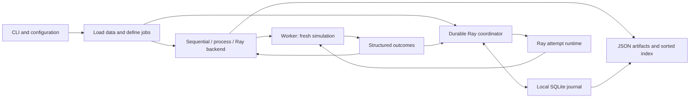

# Engineering deep dive

This backtester preserves daily simulation semantics as workers, execution order,
and failure timing change. This guide explains its engineering choices and evidence.

The current package is `0.8.0`, with engine identity
`distributed-backtester/0.8.0:daily-long-only-v1` and package source SHA-256
`a3edda1731d8694fda5d6987e570e0cca365bbee22d18bbfc0dbd116003f618f`.
The [Phase 7 verification record](phase-7-verification.json) records that identity.
Numbers below describe historical Phase 6 `0.7.0` performance, not a current benchmark.

## 1. Why a modular package fits the problem

A portfolio evolves in chronological order, but different parameter combinations
can run independently. The architecture therefore keeps one simulation local to
one worker and distributes whole jobs. Workers do not share a mutable portfolio.
This gives the sequential implementation a useful role as a reference for every
other execution backend.

These boxes represent calls and data ownership within the package. The simulation
accepts validated immutable data and configuration, then returns a complete
result. File loading, scheduling, persistence, and operational observations live
around it. See [simulation.py](../src/distributed_backtester/simulation.py),
[worker.py](../src/distributed_backtester/worker.py), and
[experiments.py](../src/distributed_backtester/experiments.py).

This boundary lets the same economic logic run without a database or Ray.
The [package metadata](../pyproject.toml) has no core runtime dependencies;
Ray, Parquet, and DuckDB are optional extras. SQLite owns durable lifecycle and
result commits. [analytics.py](../src/distributed_backtester/analytics.py) imports
verified snapshots into an analytical copy, so queries do not become scheduler
authority.

The [modular-package decision](decisions/0001-modular-package.md) explains the
choice over immediate services or an array-first framework. Separate services
would introduce deployment and network protocols before the simulation needed
them. Arrays remain a possible optimization when they preserve chronology and
exact accounting. [Backend tests](../tests/test_backends.py) and
[Ray backend tests](../tests/test_ray_backend.py) check the execution boundary.

## 2. Determinism starts with chronology and exact accounting

For every supplied daily bar, the engine performs these steps:

1. Fill the previous close's pending intent at this session's open.
2. Record equity using this session's close: cash plus shares times close price.
3. Append the completed close and let the strategy choose its next target.
4. Retain a valid intent for the next supplied session's open.

The first bar has no pending intent. A signal at the final close is canceled
because there is no following open. Existing holdings remain marked to the final
close; there is no automatic liquidation. A next-open price gap can change the
affordable quantity without changing yesterday's signal. This timing is an
idealized fill model, with no liquidity, market impact, or intraday execution.

[simulation.py](../src/distributed_backtester/simulation.py) owns this order.
[test_simulation.py](../tests/test_simulation.py) checks the hand-calculated path,
next-open gaps, future-suffix independence, terminal cancellation, and repeated
calls. Its `test_changing_next_open_preserves_signal_but_changes_fill_and_quantity`
distinguishes signal information from execution information.

The strategy receives a `CloseHistory` whose bounds are captured when the view
is created. A retained view cannot grow as later closes arrive. Frozen records
and immutable dataset tuples prevent ordinary mutation through the supported
API. Python introspection is outside this causal interface's guarantees.
See [models.py](../src/distributed_backtester/models.py) and the retained-view,
reverse-slice, and future-append cases in [test_models.py](../tests/test_models.py).

The built-in SMA strategy compares window sums by integer cross multiplication.
It starts flat, waits for the slow window, preserves its target on equality, and
emits an intent only on a target change. Each default simulation gets fresh
strategy state. A caller supplying a custom strategy owns its reset and identity.
See [strategy.py](../src/distributed_backtester/strategy.py) and
[test_strategy.py](../tests/test_strategy.py).

Money is represented as integer micro-dollars, with whole-share holdings.
[money.py](../src/distributed_backtester/money.py) parses decimal text exactly;
[execution.py](../src/distributed_backtester/execution.py) rounds proportional
fees once per fill using half-even rounding. A binary search finds the greatest
quantity affordable at the next open including that rounded fee. Return and
drawdown use exact rational values in [metrics.py](../src/distributed_backtester/metrics.py).
The independent checks are [money](../tests/test_money.py),
[execution](../tests/test_execution.py), and [metrics tests](../tests/test_metrics.py).

Reproducibility also needs identity. [jobs.py](../src/distributed_backtester/jobs.py)
hashes canonical JSON containing dataset metadata, configuration, schema, engine,
and installed-source fingerprint. Repeated grid entries retain requested
membership but execute one unique job. Worker initialization verifies the actual
installed implementation. [provenance.py](../src/distributed_backtester/provenance.py)
hashes sorted package-relative Python names and bytes, independent of checkout
location. Changing operational Python source also changes job identity.

Process IDs, timestamps, backend timings, and environment observations stay in
operational records rather than semantic results. Complete results and the final
index have stable ordering despite unordered completion. See
[results.py](../src/distributed_backtester/results.py),
[job tests](../tests/test_jobs.py), [provenance tests](../tests/test_provenance.py),
and [experiment tests](../tests/test_experiments.py).

## 3. Distributed scheduling keeps work and retained results bounded

The classic backends expose an iterator of `JobOutcome` objects. The collector
validates each outcome against its job, writes the detailed artifact, and retains
a compact record for the final job-ID-sorted index. Streaming prevents complete
equity paths from accumulating for every finished job in the coordinator.
The manifest and compact index still grow with the number of jobs.

| Backend | Implemented scheduling and data reuse |
| --- | --- |
| [Sequential](../src/distributed_backtester/backends/sequential.py) | Run one job at a time against the loaded immutable dataset. |
| [Process](../src/distributed_backtester/backends/process.py) | Spawn initialized workers, transfer data at initialization, submit small job specs, and collect completed futures. |
| [Ray](../src/distributed_backtester/backends/ray.py) | Put the dataset once, initialize persistent actors, dispatch job specs round-robin, and collect ready object references. |

Process and classic Ray default to at most twice the worker count in flight.
The bound covers submitted work and retained futures or object references, not
just a diagnostic counter. The collector's pace also controls replenishment.
[test_ray_faults.py](../tests/test_ray_faults.py) explicitly observes reference
retention while the consumer pauses; [test_backends.py](../tests/test_backends.py)
checks process submission bounds and reference parity.

Ray actors request CPU and optional custom resources with `SPREAD` placement.
Readiness checks report worker identity before dispatch. Actor restart and task
retry are both disabled, so the application owns retry policy. One `ray.put`
avoids sending the dataset with each task, but does not establish zero-copy
Python bars or unique physical memory savings.

Durable scheduling uses [RayAttemptRuntime](../src/distributed_backtester/scheduler/ray_runtime.py)
with one active attempt per actor and capacity `min(workers, max_in_flight)`.
The [coordinator](../src/distributed_backtester/scheduler/coordinator.py) retains
only active leases; historical duplicate checks resolve attempts from SQLite.
[test_coordinator.py](../tests/test_coordinator.py) checks this retention even
across a long sequence of failed attempts.

An existing Ray cluster can be selected, but durable state remains on the
coordinator's local filesystem. Resource reservations describe eligibility,
not measured CPU utilization. The [cluster guide](ray-clusters.md) documents
connection requirements; local evidence does not establish multi-machine scaling.

## 4. Worker failure is a lifecycle event owned by the coordinator

Durable mode records job definitions and retry policy before work starts.
An exclusive POSIX advisory lock admits one coordinator writer. SQLite's
write-ahead log (WAL) with `synchronous=FULL` holds durable transactions.
See [journal.py](../src/distributed_backtester/scheduler/journal.py) and
[test_journal.py](../tests/test_journal.py) for pragmas and competing-writer checks.

A claim commits before submission and spends an increasing attempt number.
Its lease authorizes that attempt; generation identifies the coordinator session.
The journal saves its number, generation, and deadline. Defaults allow three total
attempts, a 60-second deadline, and a fixed 0.1-second retry delay.
Submission, replacement readiness, calculation, and reply transport consume that
deadline. Initial pool readiness has a separate startup timeout.

The live coordinator measures deadlines with a monotonic clock and a UTC anchor
for recorded times. A reply must be observed before expiry. It retires a timed-out
actor before retrying; replacement readiness is observed without blocking the
whole scheduling loop. See [coordinator.py](../src/distributed_backtester/scheduler/coordinator.py)
and [Ray runtime tests](../tests/test_ray_runtime.py).

| Observation | Durable response |
| --- | --- |
| Recoverable worker death or transport failure | Record failure, retire the actor, and retry within the saved budget. |
| Worker exceeds its deadline | Record `JobTimeout`, retire the actor, and spend another attempt if allowed. |
| Repeated ordinary calculation failures | Exhaust the finite budget and commit a terminal failure artifact. |
| Identity mismatch, invalid reply, or fatal storage/setup error | Abort the run and retain journal state for inspection and appropriate recovery. |
| Coordinator interruption | Resume with matching data/source, advance generation, and mark abandoned running attempts interrupted. |

Interrupted attempt numbers remain spent. A budget can expire before successful
calculation, including repeated failures before work starts. Eventual success is
therefore not guaranteed. [Actual Ray fault tests](../tests/test_scheduler_faults.py)
exercise actor death before work, death during simulation, lost reply, timeout,
repeated injected failure, and coordinator restart.

Phase 7's [CLI lifecycle](../src/distributed_backtester/cli_lifecycle.py) translates
SIGINT/SIGTERM into cleanup and exits 130/143. SIGKILL bypasses Python cleanup.
Historical [Docker recovery evidence](phase-7-verification.json) records all three
paths on Linux ARM64. Cleanup has no fixed time bound; disconnecting from an
external cluster does not shut that cluster down. See the
[failure demonstration](fault-tolerance-demo.md) for selectors and evidence scope.

## 5. Duplicate calculation and duplicate commit are different events

There are two important ambiguity windows:

1. A worker finishes a simulation but dies before its reply arrives. The journal
   has no result, so a replacement can calculate the same job again.
2. SQLite commits a result, then the coordinator disappears before the caller
   observes acknowledgment or exports. The result remains authoritative on resume.

The first window is tested by the `lost-reply` real Ray case in
[test_scheduler_faults.py](../tests/test_scheduler_faults.py). The second uses an
actual subprocess kill after `Journal.commit` in [test_journal.py](../tests/test_journal.py).
Those scenarios explain the contract: at-least-once calculation as the intended
delivery model, with bounded attempts and idempotent fenced commits.
There is no exactly-once calculation guarantee.

The journal's commit table has a primary key on job ID. Artifact bytes, compact
record, job state, and attempt state change in one transaction. Before accepting
a new result, the journal checks the job, attempt number, generation, deadline,
and active state. Uncommitted expired or interrupted attempts return `stale`;
their replies cannot replace a terminal outcome.

An identical commit for the already successful matching attempt returns
`duplicate`; different result bytes or compact content raise a conflict.
This acknowledgment can still succeed after a later resume for that completed
attempt. Generation fencing rejects abandoned work while preserving acknowledgment
of existing successful commits. The tests `test_commit_duplicate_lost_ack_and_sorted_exports`,
`test_conflicting_same_completed_attempt_raises`, and
`test_resume_interrupts_and_fences_old_reply_and_clamps_wait` in
[test_journal.py](../tests/test_journal.py) cover these distinctions.

JSON exports are derived copies. Durable finalization rebuilds them from committed
SQLite bytes and publishes the index after required artifacts. A completed resume
repairs missing or truncated exports without starting workers or adding attempts;
it still advances generation. [test_coordinator.py](../tests/test_coordinator.py)
checks interrupted export and completed repair with an injected runtime.

Keep the whole experiment directory, including journal sidecars and lock file.
The [reliability guide](reliability.md) explains the single-writer local POSIX
boundary; network filesystems are unsupported. The journal has no replication or
high availability. These tests do not establish power-loss, disk-loss, or partition recovery.

## 6. Measured bottlenecks depend on the timer boundary

Phase 6 profiled four synthetic SMA jobs over 65,536 bars. Instrumented CPU
reports identified repeated Python history indexing and exact drawdown fraction
construction as useful targets. Caller and callee cumulative times overlap, so
they cannot be added to estimate an uninstrumented runtime. See the retained
[baseline CPU report](benchmarks/phase-6/profiles/baseline-cpu-simulation/report.json)
and [profiling method](performance.md).

Separate fresh-process comparisons included imports, CSV loading, worker startup,
simulation, transport, detailed JSON export, shutdown, and child exit. Generation
and post-exit validation were excluded. Each configuration had one excluded warmup
and three timed trials. These archived `0.7.0` wheels used an Apple M3 Pro,
11 available/physical cores, 18 GiB RAM, macOS 26.6.1 arm64, CPython 3.14.6,
Ray 2.59.0, and psutil 7.2.2. Seed 1729 and 10 bps fees were fixed.

| Historical workload | Candidate sequential median | Candidate process-2 median | Candidate Ray-2 median |
| --- | ---: | ---: | ---: |
| 256 bars, 128 jobs | 0.308797 s | 0.374458 s | 4.563762 s |
| 16,384 bars, 32 jobs | 2.667269 s | 2.369008 s | 7.146931 s |

The [small comparison](benchmarks/phase-6/small-comparison.json) and
[substantial comparison](benchmarks/phase-6/substantial-comparison.json) retain
these medians and full-result equality. The [raw candidate small](benchmarks/phase-6/candidate-small.json)
and [raw candidate substantial](benchmarks/phase-6/candidate-substantial.json)
reports retain individual observations and overlapping component wall timings.
Cold local Ray startup is visible in this complete-operation boundary.
The data do not isolate worker CPU or measure steady-state network throughput.

Two processes were fastest on the substantial workload; four and eight did not
scale linearly. The current code's full-result transport and coordinator export
are plausible scaling constraints, but the measurements do not quantify each
constraint's independent contribution. Three trials on one synthetic host with
uncontrolled caches and consecutive revision order give observed ranges, not
confidence intervals or a platform-wide capacity rule.

Unique set size (USS), the private-memory measure, was unavailable in the primary
trials. Resident set size (RSS) can include shared mappings and cannot be summed
into unique memory. Scoped traced peaks barely changed; no memory saving is claimed.

## 7. Effective optimizations and approaches that did not deliver

Two focused optimizations were retained, with complete results preserved:

- `CloseHistory` uses native slicing for exact built-in list/tuple backing,
  normalized against the captured prefix. Empty and reverse slices explicitly
  preserve causal bounds; custom sequences and subclasses keep the fallback.
  [test_models.py](../tests/test_models.py) checks values and bounded access counts.
- Drawdown tracks the largest loss/peak ratio using integer cross products,
  constructing only final rational values. [test_metrics.py](../tests/test_metrics.py)
  compares an independent Fraction reference and counts Fraction construction.

Historical uninstrumented scoped medians, five repetitions per scope, were:

| Phase 6 variant | Simulation only | Complete sequential experiment |
| --- | ---: | ---: |
| Original algorithm | 0.975629 s | 1.903224 s |
| Bounded backing-index generator | 0.871920 s | 1.849313 s |
| Native history slicing | 0.805127 s | 1.766037 s |
| Native slicing plus integer drawdown | 0.669989 s | 1.652131 s |

The [profiling evidence table](performance.md#uninstrumented-scoped-timing) links
the variants and reports; retained timing reports for
[baseline simulation](benchmarks/phase-6/profiles/baseline-timing-simulation/report.json),
[generator simulation](benchmarks/phase-6/profiles/generator-timing-simulation/report.json),
[native slicing](benchmarks/phase-6/profiles/native-history-timing-simulation/report.json),
and [optimized simulation](benchmarks/phase-6/profiles/optimized-timing-simulation/report.json)
record raw repetitions. These scopes exclude interpreter and worker startup;
experiment scope includes load/export, while simulation scope retains results.

The generator improved the original but lost to native slicing and was rejected.
The combined changes reduced scoped simulation median by 31.33% and scoped
experiment median by 13.19%. Fresh-process substantial sequential median fell
from 3.821517 to 2.667269 seconds, a 30.20% reduction. Substantial multiprocessing
changed by less than 1%; Ray medians increased 1.30-7.05% in those samples.
Faster simulation therefore did not establish a distributed speedup.

The measured baseline was commit `58837ac10216dcc2379d0b7ef0f5f3779466e4f7`;
candidate was `df294d4788673e0180d0dc67715c955407a95372`, both release `0.7.0`.
[Baseline installation](benchmarks/phase-6/baseline-installation.json) and
[candidate installation](benchmarks/phase-6/candidate-installation.json) identify
their wheel/source bytes. [performance.py](../src/distributed_backtester/performance.py)
validates complete artifacts and economic fields across revisions, allowing only
a validated release-label normalization. [test_performance.py](../tests/test_performance.py)
rejects changed traces even when summary metrics match.

More workers and smaller input files were also insufficient shortcuts.
Historical [Phase 5 storage observations](benchmarks/phase-5/results.md) found
smaller Parquet files without an established complete-experiment speedup. Loading
still reconstructs Python bars; separate CLI processes do not share the explicit
in-process cache. These findings motivated profiling rather than assuming a
format or backend change would remove the dominant costs.

## 8. Proposed changes for larger scale, not implemented or measured

The following proposals follow from current ownership and data paths. Each needs
new workload evidence and correctness/recovery validation before adoption.

| Proposed change | Code-based motivation | Required evaluation |
| --- | --- | --- |
| Batch small jobs or retain a warm pool | Classic backends submit individual jobs; cold startup dominates some recorded workloads. | Include lifecycle cost and preserve per-job identity, bounded retention, and retry isolation. |
| Compact immutable columnar worker data | Every worker currently uses Python bar objects, even after Parquet loading. | Measure decoding/transport/private memory and preserve exact prices and prefix visibility. |
| Incremental window sums or native kernels | SMA currently sums each requested window. | Preserve equality, target changes, next-open fills, fee rounding, and every complete result field. |
| Optional summary-oriented output | Every result contains the full equity path and travels to the collector. | Define a versioned output contract and quantify simulation, transport, export, and audit tradeoffs separately. |
| Separate immutable artifacts from lifecycle transactions | The journal stores full result bytes and JSON duplicates them. | Design atomic publication/references, orphan cleanup, hash validation, and lost-ack recovery. |
| Replicated metadata and coordinator failover | One local POSIX writer is the current recovery boundary. | Establish leases/fencing across hosts and explicitly test partitions, failover, storage loss, and availability. |

These proposals need new evidence. The existing [architecture reference](architecture.md),
[technical explanation](technical-explanation.md), and
[durable-scheduling decision](decisions/0006-durable-scheduling.md) give the
implementation contracts to preserve. The [fault demonstration](fault-tolerance-demo.md)
shows the recovery boundaries already exercised.
