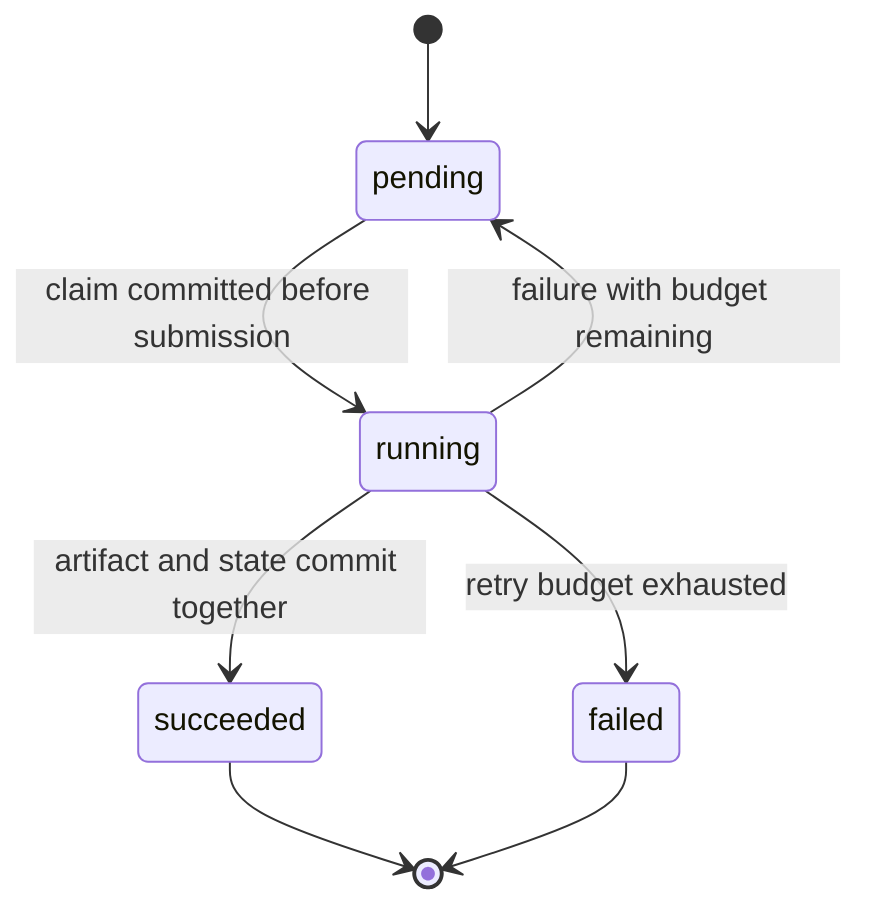

# Durable execution and recovery

Phase 4 adds an opt-in Ray scheduler. The ordinary backtest and sweep commands
keep their existing behavior. This mode requires a local POSIX filesystem and
the optional Ray extra. Its SQLite journal does not require a new dependency.

## Commands

From Terminal or VS Code's terminal, with the project environment activated:

```bash
python -m pip install --editable ".[dev,benchmark,distributed]"
distributed-backtester sweep --data examples/sma.csv --symbol SYNTH \
  --price-basis raw --fast 1 2 --slow 3 4 --fee-bps 10 \
  --backend ray --workers 2 --durable --max-attempts 3 \
  --job-timeout 60 --retry-delay 0.1 --output-dir artifacts/durable-demo

distributed-backtester status --output-dir artifacts/durable-demo
distributed-backtester resume --data examples/sma.csv \
  --workers 2 --output-dir artifacts/durable-demo
```

The start command requires a new directory. Resume requires the existing journal,
the identical CSV bytes, and the identical installed package source. It reads the
symbol, strategy grid, fees, initial cash, and retry policy from the journal.
Changing a worker count or Ray resource setting is allowed. Changing economic
inputs, retry policy, or source code requires a new experiment.

`status` works without importing or installing Ray. It reads a consistent database
snapshot while a coordinator is working. Job counts and attempt history explain
progress and failures. It does not acquire the coordinator's exclusive writer lock.
Exit codes are 0 for success, 1 for a completed experiment with terminal job failures,
and 2 for input, lock, storage, setup, or protocol errors.

## Files and authority

| File | Role |
| --- | --- |
| `journal.sqlite3` | Authoritative job definitions, policy, leases, attempts, events, and full committed artifacts |
| `journal.sqlite3-wal`, `journal.sqlite3-shm` | SQLite-managed working files; do not remove them while processes are connected |
| `coordinator.lock` | Advisory lock held by the sole writer; its existence alone does not mean a process is running |
| `manifest.json` | Export of the authoritative experiment definition |
| `results/<job_id>.json` | Export of one committed terminal outcome |
| `index.json` | Final compact export, published after every required artifact |
| `execution.json` | Operational environment, generation, worker diagnostics, and retry policy |

Every terminal artifact and its job state commit in one SQLite transaction. A
primary key prevents a second terminal record for the same job. Export files are
rebuildable copies, not a second authoritative store. Resume repairs known export
paths, including truncated files, from committed database contents. It never reads
an export as the source of truth. Put the input CSV outside the experiment directory.

The journal records whether the coordinator last finished publication. External
file deletion or corruption can invalidate that export afterward; resume rebuilds
it. Use artifact hash verification when consuming exported results. Do not manually
edit the journal or copy only its main file while a writer is active.

## Lifecycle and deadlines



Each attempt receives an increasing number and the current coordinator generation.
The attempt's ID is derived from the stable job ID and number. Resume increments
the generation and marks abandoned running attempts as interrupted. Their numbers
remain spent. A completed job is not executed again, even if its JSON export is
missing. Old replies cannot use a new attempt's lease.

The default policy allows three total attempts, a 60-second deadline, and a fixed
0.1-second retry delay. The first calculation counts as attempt one. Submission,
replacement actor startup, worker execution, and reply transport count toward the
deadline. A reply must be observed before it expires. Initial pool startup has its
own bounded readiness wait. Timeouts retire the actor before retrying.

The live coordinator uses a monotonic clock for deadlines and a UTC anchor for
recorded times. Restart discards old live deadlines and fences their leases; it
does not compare a previous process's monotonic clock with the new process's clock.
Persisted retry delays are bounded again on resume to tolerate wall-clock changes.
Fixed delay and attempt limits are deterministic policy. The occurrence and timing
of machine failures are not deterministic.

## Actual guarantee

Execution can repeat. A worker can finish a calculation and lose its reply, causing
a retry. A committed result whose acknowledgment is lost remains committed.
Identical duplicate commits are acknowledged; conflicting duplicates are rejected.
Late replies from expired or interrupted attempts cannot overwrite terminal state.

This is bounded retry behavior with at-least-once execution as the intended delivery
model, and at most one committed terminal outcome per job within one journal.
A finite budget can be exhausted before a worker starts, so eventual execution or
success is not guaranteed. We do not claim exactly-once calculation.

Only this coordinator writes the local journal. During a network partition,
termination of an old actor may take time; fencing protects commits even if two
calculations overlap. Ray's own actor restarts and task retries are disabled.
Cleanup targets experiment actors and this driver connection; an externally owned
cluster continues running.

## Limits

The journal is neither replicated nor highly available. A replacement coordinator
must access the original local journal. This phase does not support durable mode
on Windows or network filesystems. SQLite WAL requires processes sharing a host
and depends on filesystem guarantees. Process termination tests establish crash
recovery for those tests, not safety under arbitrary power loss or disk damage.

Result bytes are stored twice, in SQLite and JSON. Transactional full-result writes
and one coordinator can limit throughput. No performance improvement is claimed
in this phase. Multi-machine partitions and disk loss need separate validation.
See [ADR 0006](decisions/0006-durable-scheduling.md) for the alternatives and
[Phase 4 report](phase-4-report.md) for actual verification evidence.
